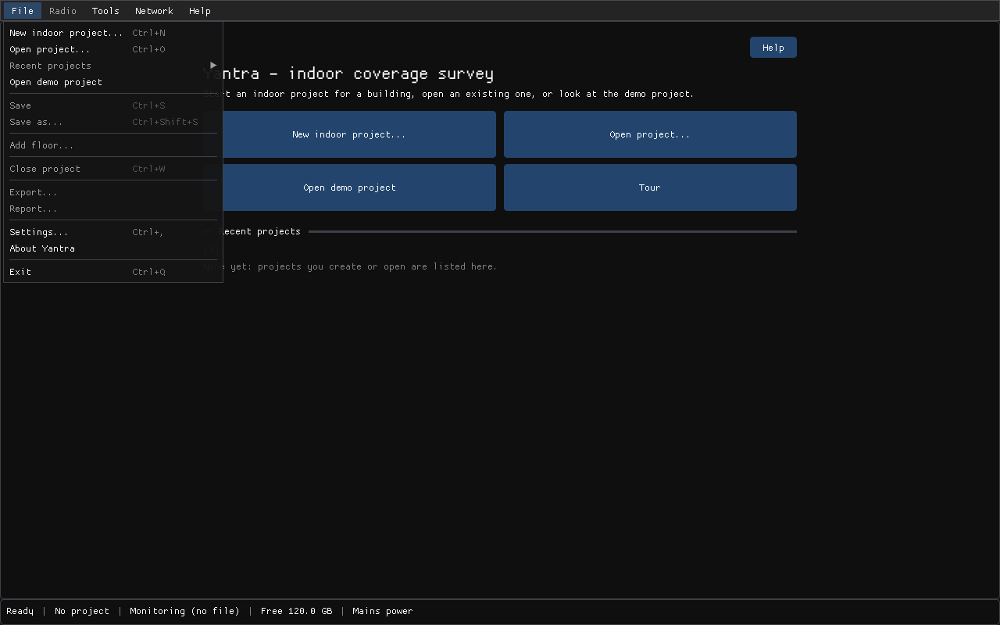

<!--
SPDX-FileCopyrightText: 2026 The Yantra contributors
SPDX-License-Identifier: GPL-3.0-or-later
-->

# Yantra

An open-source tool for measuring and reporting TETRA coverage inside
buildings, floor by floor, with a software-defined radio (SDR).

Yantra is made by [curtat.be](https://curtat.be) as a reference on building
new programs with Claude, Anthropic's AI assistant.

## What Yantra is

Yantra is an indoor tool, for example for DAS and indoor-coverage
projects:

- describe the building in its first tab, About building: the address
  with an OpenStreetMap map, a photo (from a file or taken with the
  camera), the surveyor, the survey date and notes;
- import floor plans (PDF or image), cut several floors out of one sheet,
  scale them and line them up;
- walk the floors with a radio and click your position on the plan (or
  practise with the mouse and the simulated radio);
- keep notes on the plan: a long press on a spot adds a picture, a text
  and a short audio recording, shown as a numbered pin;
- watch the cells live: levels, C1, quality, the decoded broadcast
  information and the neighbour lists, and the TETRA band's spectrum and
  waterfall (Tools > Spectrum) from a radio that measures it;
- check the network against its cell database;
- get a coverage map interpolated from your measured points, with a
  confidence mask where nobody measured;
- write a coverage and acceptance report (PDF and HTML) per floor and for
  the building, against acceptance profiles on the measured points, the
  tested area or the floor area; a failing profile names its weak areas,
  and a popup opens the finished report.

The project window has two tabs for the two parts of the work: **Walk**
(the radio, the live values, the walk test and the recording) and **Map**
(show the plan, the points and the coverage map, compute the map, and an
Advanced dropdown for the interpolation, binning, post-processing and
acceptance settings). The survey windows (neighbours, graphs, scanner,
events, statistics) open from the Window menu, and the report is
File > Report. Yantra models no walls or antennas: the map comes from
the measured points alone (inverse-distance weighting, IDW,
[docs/INTERPOLATION.md](docs/INTERPOLATION.md)).

Yantra reads only broadcast and system information, levels and quality.
Short data messages, subscriber addresses, voice and decryption are out of
scope by design, and there are no outdoor drive tests or GPS; the only
map is the OpenStreetMap map of the building's address. See
the [legal and scope note](docs/LEGAL.md).

A sample report of the demo project, as Yantra writes it:
[PDF](docs/samples/fraunces_report.pdf) and
[HTML](docs/samples/fraunces_report.html).

## Supported radios

Radios are plugins. The radio parts (the radio API, the radio plugins,
their receiver and TETRA decoder, the test-signal generator; formerly the
separate yantra-radios project) are in the `radios/` folder of this
repository (PLG-29). The shipped radio plugins:

- **Simulator**: a simulated TETRA network and devices, no hardware
  needed; it drives the demo and the tour.
- **HackRF**: HackRF One.
- **SoapySDR**: any SoapySDR radio, for example RTL-SDR and Airspy, and
  network radios through SoapyRemote.
- **TETRA terminal (PEI)**: a terminal's own measurements over its serial
  port (terminal mode).

Hardware status: none of these radios has been measured with Yantra on
real hardware yet; they are tested with simulated and fake devices. The
hardware tested so far is listed in `radios/DEVICES.md`.

Yantra's own plugins: the TETRA technology plugin and the probe plugin
(the remote API of the headless probe).

## Install

**Linux**: build from source; `ninja -C build deb` then makes a .deb
package of the build ([BUILD.md](BUILD.md#linux-package-nfr-09)). The radio plugins
are built from `radios/` (PLG-29); its osmo-tetra decoder library is a git
submodule:

    git clone https://github.com/peterdewitte/yantra.git yantra
    cd yantra
    git submodule update --init --recursive
    cmake --preset default
    ninja -C build
    ctest --test-dir build -j"$(nproc)"

[BUILD.md](BUILD.md) has the dependencies, the build options, the radio
plugin build (or a prebuilt yantra-radios package), the USB permissions
for the radios and the plugin folders.

**Windows** (10 or 11, x64): two packages of the same files, made from
the cross build on Linux ([BUILD.md](BUILD.md#windows-packages-nfr-09)):

- `yantra-<version>-windows-x86_64.zip`, the portable zip: unpack it
  anywhere and start `bin\yantra.exe`; nothing is installed;
- `yantra-<version>-windows-x86_64-setup.exe`, the setup: installs for
  the current user (no administrator rights) into
  `%LOCALAPPDATA%\Programs\Yantra`, with a Start menu entry and an
  uninstaller (Settings > Apps); silent: `setup.exe /S`.

Both hold the app, `yantra-probe`, the plugin test kit, the plugins with
the self-contained radio plugins of yantra-radios and its radio tools
(`yantra-hackrf`, `yantra-radio-host`, the test-signal generator
`yantra-gen` with its scenarios), every DLL they need, the demo project,
the PDF user manual and the licence texts (`SOURCE.txt` names the source).
Yantra needs a graphics driver with OpenGL 3.3. USB radios (HackRF One,
RTL-SDR, Airspy) need the WinUSB driver, installed once per device with
[Zadig](https://zadig.akeo.ie). User settings and data are in
`%APPDATA%\yantra`, caches in `%LOCALAPPDATA%\yantra`.

## First steps

1. Start `build/yantra`. The start screen offers the tour, the demo
   project, a new indoor project and your recent projects.
2. Take the tour (Help > Tour, or `yantra --tour`): it goes through a
   whole indoor survey of an example building with the simulated radio,
   from the plan to the report, without hardware.
3. Then follow the quick starts:
   [first indoor project](docs/quickstart/01-first-indoor-project.md),
   [indoor walk test with acceptance report](docs/quickstart/02-walk-test-acceptance.md)
   and [calibrate a radio](docs/quickstart/03-calibrate-a-radio.md).

`yantra --demo` opens the demo project (the Fraunces Tavern, two floors,
simulated walks) directly.

The indoor workflow in eight seconds, from the start screen through the
plan import, the walk test and the coverage map to the report (also as
[WebM](docs/img/indoor_workflow.webm)):

## Documentation

- [User manual](docs/manual/README.md): every window and function; also
  in the app (F1 and the Help buttons) and as one PDF with contents,
  bookmarks and an index, `yantra-manual-<version>.pdf` (Help > User
  manual (PDF); in the packages, or `ninja -C build docs-manual`). The
  manual is in English only for now; the quick starts are also in Dutch,
  French and German (DOC-06).
- [Quick starts](docs/quickstart/README.md): one page each.
- [Measurement method note](docs/METHOD.md): what is measured and how,
  calibration and its uncertainty, the interpolation and its limits.
- [Legal and scope note](docs/LEGAL.md): receive-only, what is decoded,
  privacy and licences.
- For developers: [architecture](ARCHITECTURE.md),
  [building](BUILD.md), [contributing](CONTRIBUTING.md),
  [plugins](docs/PLUGINS.md),
  [the building model](docs/BUILDING_MODEL.md),
  [the measurement pipeline](docs/MEASUREMENT_PIPELINE.md),
  [calibration](docs/CALIBRATION.md),
  [the cell database](docs/CELL_DATABASE.md),
  [the coverage map](docs/INTERPOLATION.md), [reports](docs/REPORT.md),
  [the headless probe](docs/PROBE.md) and its [API](docs/API.md),
  [the demo](docs/DEMO.md).

## Contributing

See [CONTRIBUTING.md](CONTRIBUTING.md).

## Licence and credits

Yantra is free software under the GNU General Public License, version 3 or
later (`GPL-3.0-or-later`, see [LICENSE](LICENSE)). The radio plugins
contain AGPL-3.0 parts (osmo-tetra); the complete corresponding source is
available at the source link below. Every file carries an SPDX header or a
`REUSE.toml` entry; the project is checked with
[reuse](https://reuse.software). Third-party libraries, tools, fonts and
data are listed with their licences in [THIRD_PARTY.md](THIRD_PARTY.md).

The Yantra logo in `data/logo/` is part of Yantra (GPL-3.0-or-later). The
curtat.be name and the logo in `data/branding/` are a trademark of Curtat
BV and are not covered by the GPL; forks must remove or replace the logo.

Source: https://github.com/peterdewitte/yantra
(clone: https://github.com/peterdewitte/yantra.git). Homepage:
https://curtat.be. Maintainer: Curtat BV <info@curtat.be>.

## Project history

- 2026-10-30: development of Yantra started (first build, specification
  v0.1).
- 2026-11-03: the radio plugins moved to their own project, yantra-radios
  (released as v0.1.0 on 2026-11-04).
- 2026-11-04: this repository started for specification v0.2, on top of
  yantra-radios v0.1.0.
- 2026-11-09: release 0.1.0 (specification v0.2).
- 2026-11-12: release 0.2.0 (specification v0.3): Windows x64, clang,
  the PDF user manual.
- 2026-11-17: specification v0.4, not yet released: a simpler indoor
  workflow (Walk and Map tabs, the IDW coverage map, fixed demo scenes;
  walls, antennas and the ray tracer removed).
- 2026-11-20: yantra-radios merged into this repository with its
  history (radios/, its releases tagged radios-v0.1.0 .. radios-v0.4.0;
  specification v0.6, PLG-29).
