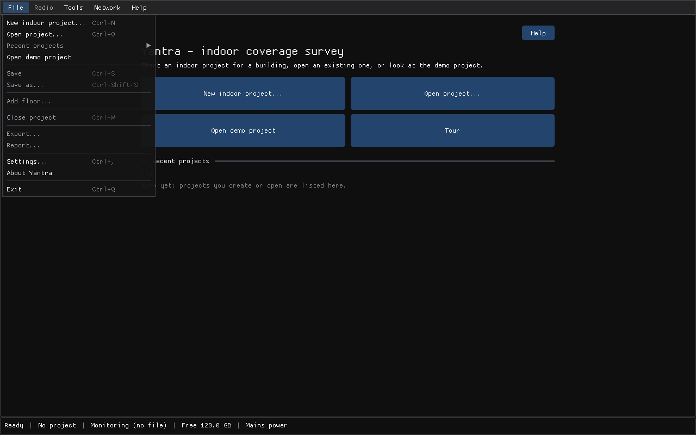
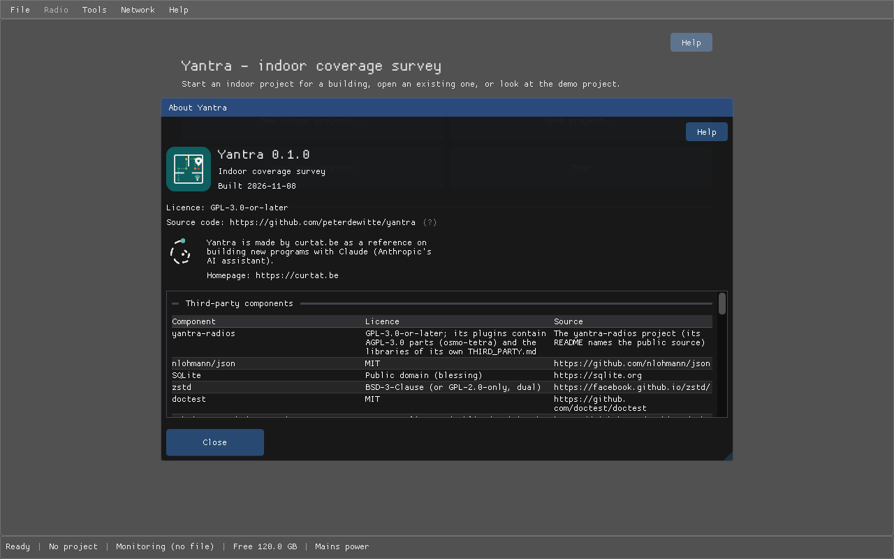

<!--
SPDX-FileCopyrightText: 2026 The Yantra contributors
SPDX-License-Identifier: GPL-3.0-or-later
-->

# 1 Getting started

Yantra measures TETRA networks inside buildings: you import floor plans, draw the walls and the antennas, walk the floors with a radio and get coverage maps and an acceptance report. It is an indoor tool only: there are no outdoor drive tests, no GPS and no geographic maps. Yantra handles what every base station broadcasts in the clear (cell identity, broadcast parameters, neighbour lists), levels and signal quality; it never decodes messages, subscriber addresses or voice (see the [legal and scope note](../LEGAL.md)). How each value is measured is in the [measurement method note](../METHOD.md); short step-by-step guides are the [quick starts](../quickstart/README.md).

Yantra is made by curtat.be (https://curtat.be) as a reference on building new programs with Claude, Anthropic's AI assistant.

### What you need

- A Linux PC. Yantra is built from source for now (README, "Install"); packages are planned. A Windows version is not yet available.
- A radio that one of the radio plugins supports (chapter 2): a HackRF One, an RTL-SDR, an Airspy or another SoapySDR radio, or a TETRA terminal with a PEI cable. None of these radios has been measured with Yantra on real hardware yet: the radio plugins are tested against simulated devices, and their hardware status is kept in DEVICES.md of the yantra-radios project. Always check a new radio against a known signal (chapter 3) before you trust its levels.
- No radio at all for learning and demonstrations: the simulator "Demo (simulated network)" is always there.

### Radio drivers and permissions (Linux)

USB radios need read and write access for your user. The yantra-radios project ships the rules: `udev/60-yantra-sdr.rules` (HackRF, RTL-SDR, Airspy) belongs in `/etc/udev/rules.d/` (an installed package puts it in `/lib/udev/rules.d/`); reload the rules and plug the radio in again. An RTL-SDR also needs the DVB-T television driver kept away from it: `udev/yantra-rtl-sdr-blacklist.conf` goes into `/etc/modprobe.d/`. A TETRA terminal on a serial port needs your user in the `dialout` group (log in again afterwards). When access is missing, the radio list (2.1) shows the device with the reason and the remedy. Windows drivers (Zadig/WinUSB) belong to the Windows version, which is not yet available.

## 1.1 The start screen

The start screen offers New indoor project, Open project, the demo project, the recent projects and the guided tour. Every button explains itself when you rest the pointer on it; a greyed button says why it cannot be used yet. On the very first start it also offers the guided tour once (1.3).

 [light theme](../img/start_menu_light.png)

### Demo mode

File > Open demo, or `yantra --demo` on the command line, opens the demo project: the Fraunces Tavern in New York with two floors, walls, DAS antennas, simulated walk tests and their coverage maps, and the simulated radio "Demo (simulated network)". The demo opens a copy in your data folder, so you can change it freely; it is renewed only when a newer version of Yantra brings a newer demo. The demo is marked as such: `[DEMO]` in the window title, a DEMO banner over the plan and the DEMO label on its reports; simulated measurements carry the simulated flag wherever they are shown or exported.

### Where Yantra keeps your files

- Projects: wherever you save them (`*.yantra`), with their recordings in a `recordings` folder, exports in `exports` and reports in `reports` next to the project file.
- Settings: `~/.config/yantra/` (`app.json` for the app, `plugin_state.json` for the plugins and the radio devices).
- Level calibration: `~/.local/share/yantra/calibration.json` (one table per user, chapter 3).
- The demo copy, the tour's projects and the plugins' own data: `~/.local/share/yantra/`.
- The ring buffer (6.1) and downloaded example plans (1.3): `~/.cache/yantra/`.

The folders follow `XDG_CONFIG_HOME`, `XDG_DATA_HOME` and `XDG_CACHE_HOME` when you set them.

### Help in the app

Every control has a tooltip when you rest the pointer on it, with its shortcut key in brackets. A dimmed "(?)" after a setting or heading explains it in more words and names the manual section. A greyed control stays hoverable and says why it is greyed and what to do (for example "Set the floor scale first"). Measured values and decoded fields explain themselves on hover: name, unit and where the value comes from. Each window and page has a Help button at its top right that opens its section of this manual, and F1 opens the help of the window in front. The manual is installed with Yantra, so the help works without a network. Tooltips can be switched off and their delay set in File > Settings > General (15.1); the "(?)" markers and the reasons of greyed controls always stay.

## 1.2 About Yantra

Help > About (also File > About) shows the Yantra logo, the version, the build date, the licence (GPL-3.0-or-later) with the link to the source code and the note on the AGPL-3.0 parts of the radio plugins, the curtat.be logo and statement with its homepage, the third-party and data credits and the loaded plugins with their versions, licences and status.

 [light theme](../img/about_light.png)

## 1.3 The guided tour

Help > Tour (also offered on the start screen the first time, and `yantra --tour`) walks through a whole indoor survey on an example building, in demo mode: the DEMO label is shown throughout and the radio is the simulator "Demo (simulated network)", so no radio is needed.

The first step chooses the building. The Fraunces Tavern comes with Yantra. The three MAK buildings (Beer house, Haus Claeson, Villa Bunzl) use a plan sheet of the MAK collection in Vienna that Yantra does not ship: the tour asks first, and only after you agree downloads the sheet once into your cache folder (`~/.cache/yantra/mak`, or the folder in `YANTRA_MAK_CACHE`). Only the plain request is sent, with the program name and version. The file is checked against its SHA-256, size and pixel size and kept unchanged; the project refers to it. The credit, the licence (CC BY-NC-ND 4.0) and the note that the scale is approximate are shown with the plan. If you say no, there is no network, or the file is not the expected one (the message shows both SHA-256 values and the address), the tour continues with the Fraunces Tavern.

The steps: a new indoor project, the plan sheet, several floors trimmed from it, a floor from a second plan (the Fraunces Tavern only), the scale, walls, DAS antennas, the mouse survey (move the mouse slowly over the plan; a click starts the interpolation; the simulator reports its levels in dBm, so no calibration is needed, 7.1), the points and the coverage map, switching floors, the report (File > Report, 10.2) and the finished example project.

Each step frames the control it is about in orange and says what to do. Do it yourself, or press Show me: it does the step with the example's data through the same commands. Back repeats a step, Skip goes on, Leave closes the tour; Help > Tour opens it again where you left it. Reset all settings (15.4) starts the tour over.
