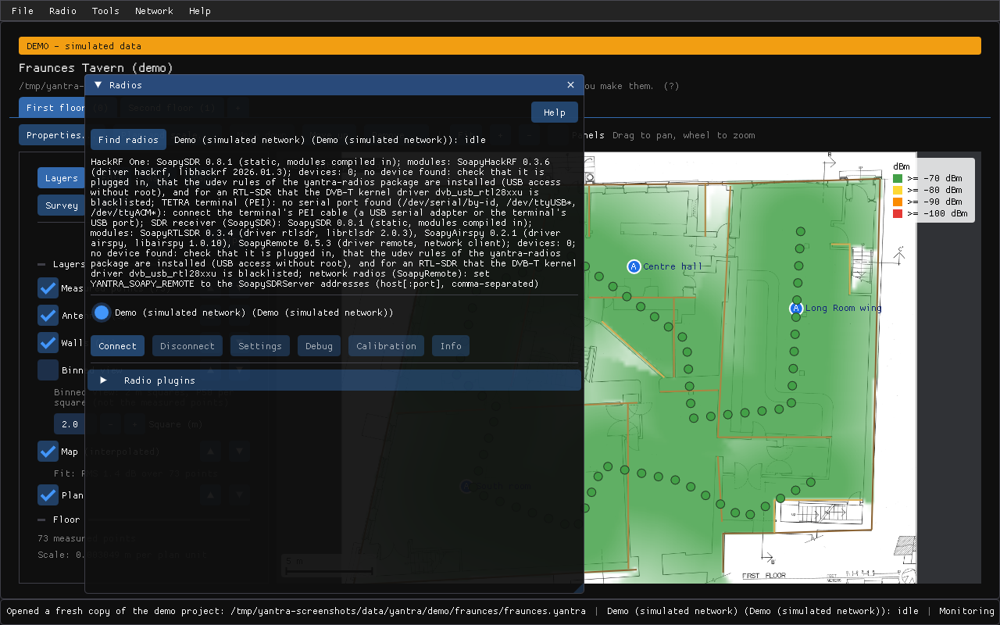
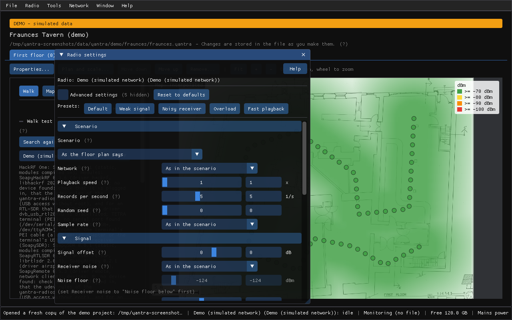
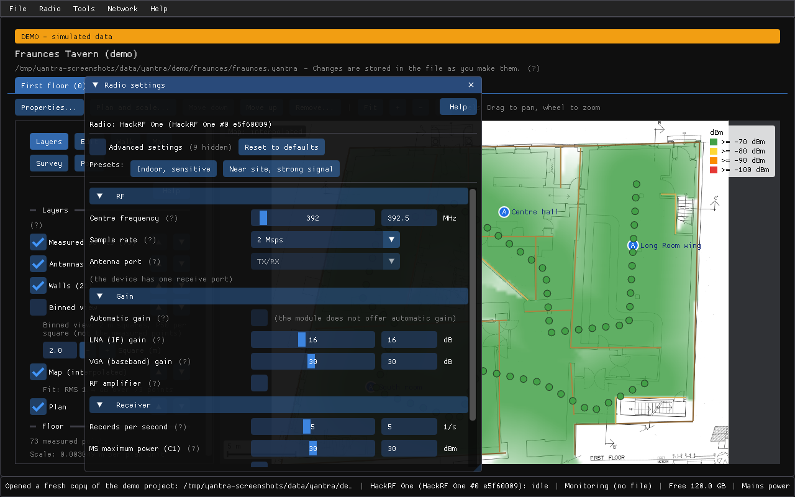
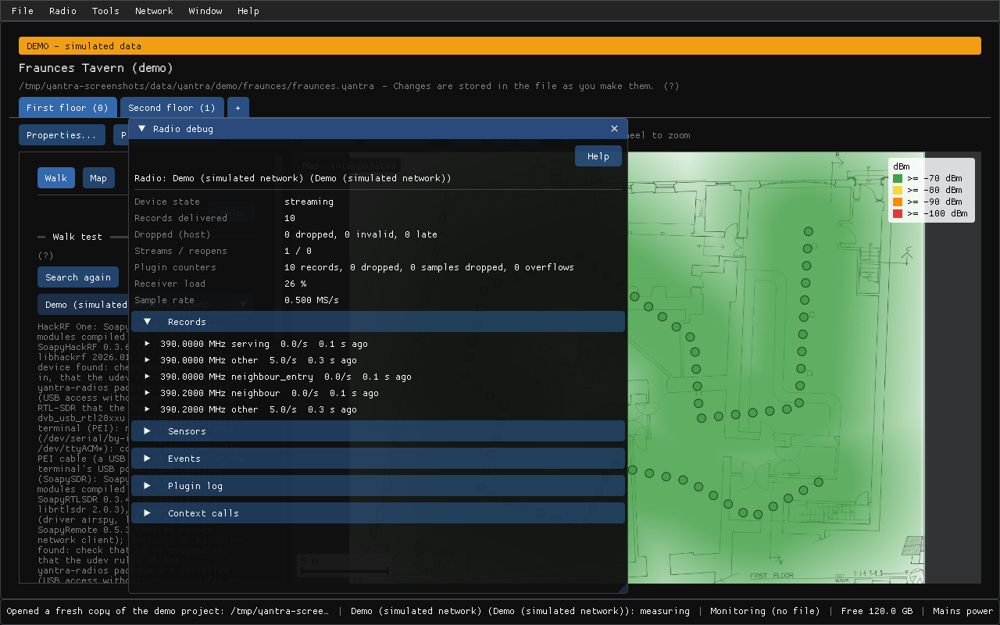
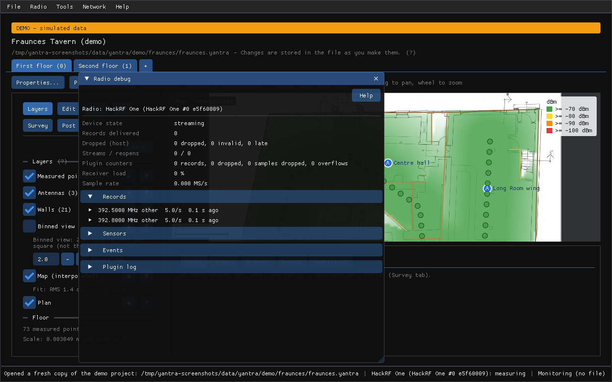
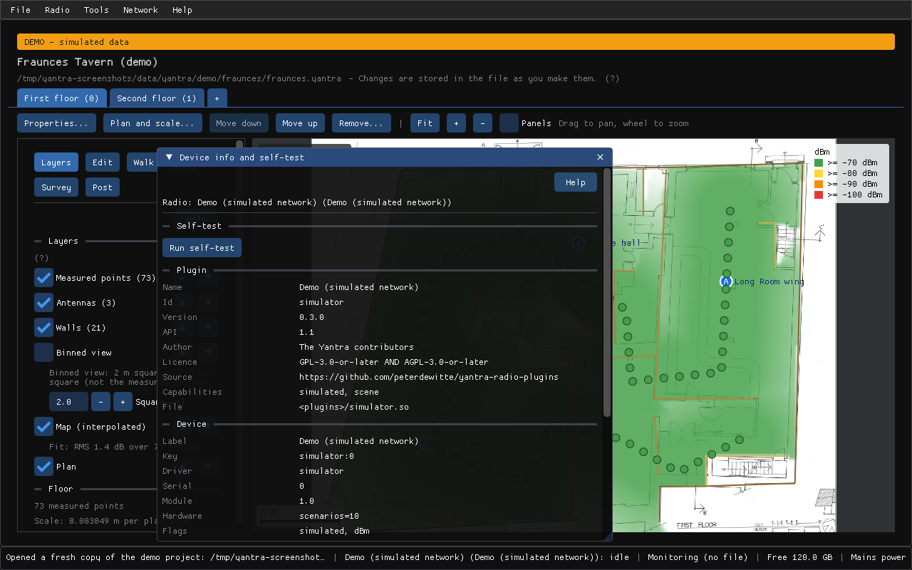
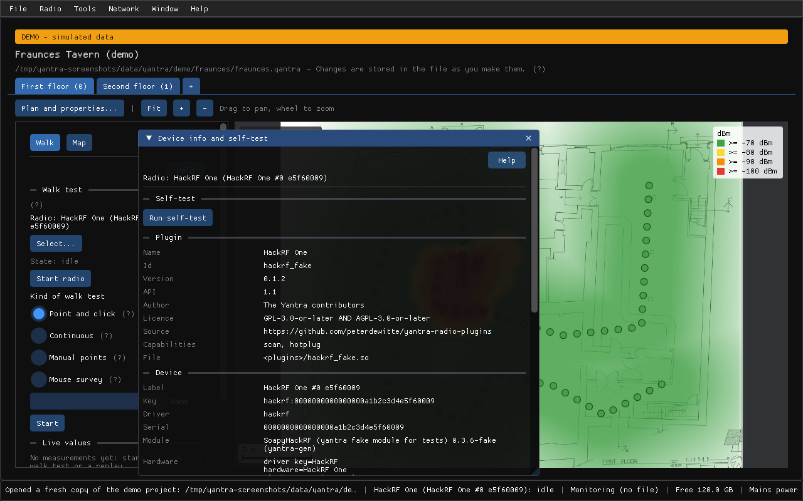

<!--
SPDX-FileCopyrightText: 2026 The Yantra contributors
SPDX-License-Identifier: GPL-3.0-or-later
-->

# 2 Radios

Radios are plugins (chapter 14) from the radio parts. Each radio plugin processes its radio's signal itself and gives Yantra measurement records only: levels, cell identity, quality, C1, broadcast parameters and neighbour lists. Yantra lists the devices every radio plugin finds and builds the windows of each radio from what the plugin declares, so every radio has the same four windows: settings, debug, calibration and device info.

The Radio menu (once a project is open) opens the radio list, finds radios again and opens the windows of the chosen radio; below that, every radio plugin has a submenu with its devices and their windows. A plugin that cannot be used is greyed out, and its tooltip says why: the radios were not searched yet (Find radios), no device was found, every device is in use by another program or not accessible (for example missing permissions), or the plugin is switched off or could not be loaded. Opening a radio window for a device chooses and connects it.

### The shipped radio plugins

- Simulator, "Demo (simulated network)": a simulated TETRA network, always present, for demos, training and tests. It follows the floor plan: on a bundled example floor it simulates that building's fixed demo scene, on your own floor its scenario's own levels, and during a walk test or a mouse survey it measures at your position. Its settings choose the scenario and network, the playback speed, noise, fading, oscillator error and gain, the position source, and a simulated signal generator for practising calibration (3.1). Its levels are in dBFS like an SDR's, and every record is flagged simulated.
- HackRF (`hackrf`): the HackRF One. Settings: centre frequency, sample rate, LNA (IF) and VGA (baseband) gain, RF amplifier, offset tuning, C1 from a level offset, the scan dwell time and two presets, "Indoor, sensitive" and "Near site, strong signal". The antenna port power (bias tee) asks before it switches on and is off again at every open, replug and close. The HackRF has 8-bit samples: near a site lower the gains until the Clipping sensor stays at 0.
- SDR receiver (`soapysdr`): every other radio of the built-in SoapySDR modules: RTL-SDR (also the RTL-SDR Blog V4), Airspy and network radios through SoapyRemote (the servers named in the environment variable `YANTRA_SOAPY_REMOTE`, `host[:port]`, comma-separated; there is no network discovery). The gains, antennas and module settings are those of the radio opened.
- TETRA terminal (`pei`): a TETRA terminal read over its PEI cable, chapter 9.

The SDR plugins deliver levels in dBFS, which Yantra turns into dBm with your calibration (chapter 3); the terminal delivers dBm itself. The SDR plugins also have a GSMTAP output under Advanced settings, for looking at the decoded broadcast messages in Wireshark: it is off by default and sends UDP packets only to the address you set.

### Hardware status

The radio plugins are tested against simulated SDR devices and a simulated terminal; none of the radios above has been measured with Yantra on real hardware yet. DEVICES.md in the radio parts lists what has been checked per device. Until a radio has a row there, check it yourself: calibrate it against a known signal (3.1), compare it with a reference radio and keep the antenna away from the PC (3.1, "Reference noise").

## 2.1 The radio list

Radio > Radios... (also Select... next to the radio in the Walk tab) lists every device found, with its plugin, state and serial number. Choose a row, then Connect opens the device and Disconnect closes it (not while it measures); Find radios searches again, for example after plugging a radio in. A device that cannot be opened is listed with the reason, for example missing USB permissions (1, "Radio drivers and permissions"). Plugins lists the radio plugins with their status, API version, licence and capabilities. Unplugging a radio while it measures stops it and flags its values (device lost); plug it in and choose Find radios to bring it back.

 [light theme](../img/radio_list_light.png)

## 2.2 Radio settings

The settings window of a device shows the plugin's settings in groups, with their units and ranges: a checkbox, a list, a slider with a typed field, or a text field. A typed value is checked before the radio sees it and applied when you leave the field (Enter, Tab or a click elsewhere). The value the device reports back is shown next to the one you asked for when they differ. Greyed settings say why they are not available. Settings marked as needing a restart apply after you confirm a restart of the stream; settings with a warning ask first. Advanced settings shows the rest. Presets set several settings at once, and Reset to defaults puts the plugin's defaults back (it asks first). The settings of each device are kept and applied again the next time you open it.

Settings that change the radio's gain are part of its calibration key: a calibration made at one gain is used only at that gain (3.1).

 [light theme](../img/radio_simulator_settings_light.png)
 [light theme](../img/radio_hackrf_settings_light.png)

## 2.3 The debug window

The debug window shows the device state, the counters of the radio host and the plugin (records, drops, overflows), the latest measurement record of every carrier with all its fields and flags and the record rate over 10 seconds, the sensors (for an SDR for example clipping, noise floor, overflows and receiver load), the events and the device log. It never shows raw samples: the radio's samples stay inside its plugin.

 [light theme](../img/radio_simulator_debug_light.png)
 [light theme](../img/radio_hackrf_debug_light.png)

## 2.4 Device info and self-test

The device info window shows the plugin and device entries, module, hardware and firmware versions, the calibration key and the sensors, and runs the plugin's self-test with a pass, warning or fail per item and what to do when an item fails. The self-test cannot run while the radio measures.

 [light theme](../img/radio_simulator_info_light.png)
 [light theme](../img/radio_hackrf_info_light.png)
