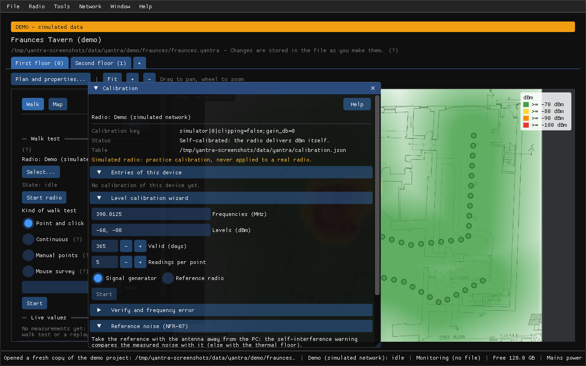
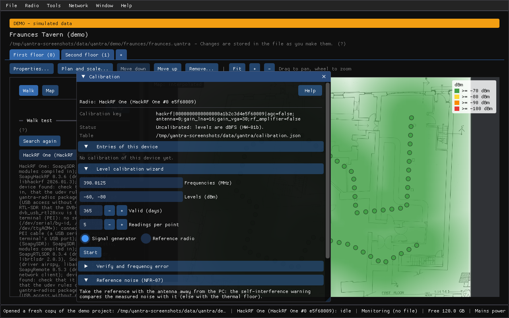

<!--
SPDX-FileCopyrightText: 2026 The Yantra contributors
SPDX-License-Identifier: GPL-3.0-or-later
-->

# 3 Measurement and calibration

The radio plugin measures every carrier it hears and sends Yantra a record per carrier about once a second: the level, the cell identity, quality values when the carrier is decoded, C1 when the radio gives it, the broadcast parameters and the neighbour list. Yantra turns the levels into dBm with your calibration, checks every record and gathers them into one measurement cycle per second (five per second in a mouse survey), with a sample for every carrier. Everything you see, record, export and report comes from these cycles. The [measurement method note](../METHOD.md) explains each value and its limits in detail.

What you see:

- Level (RSSI): the power of the whole TETRA carrier at the antenna connector, in dBm. An SDR measures it in dBFS (relative to its own full scale); without a calibration for the radio and its gain settings the level stays in dBFS and is marked uncalibrated.
- C1: the path-loss criterion of the cell (EN 300 392-2), from the radio, or calculated by Yantra from the calibrated level, the cell's broadcast access parameters and the MS maximum power set for the radio (marked estimated). An uncalibrated level gets no C1.
- Quality: what the decoder measures on a decoded carrier, for example MER, EVM, SNR, bit error rate, CRC error rates per channel and the frequency error.

Every value carries flags that say how far it can be trusted: no sync (a level without a decoded identity), overload (clipping), uncalibrated, simulated, held (no new record this cycle, the last value repeated), stale (too old), late, device lost, data loss and C1 estimated. A flagged value is still shown and stored, with its flags.

Antenna gain and cable loss: Yantra measures at the radio's antenna connector. This version applies no antenna or cable correction, so state the antenna and cable you used in the project notes or the report.

## 3.1 Level calibration

Radio > Calibration... (or the calibration window of a device) holds the level calibration of the chosen radio. A calibration is kept per calibration key: the radio's driver and serial number together with the settings that change its gain (marked "Part of the calibration key" in the settings window, 2.2). Change the LNA gain and you need a calibration for the new value. The window shows the key, its status (valid, expired or uncalibrated) and the entries of this device, each with a Remove button. A radio that measures in dBm itself (a TETRA terminal) needs no calibration.

 [light theme](../img/radio_simulator_calibration_light.png)
 [light theme](../img/radio_hackrf_calibration_light.png)

### The calibration wizard

- Connect a signal generator (Signal generator) or put a calibrated reference receiver next to the antenna (Reference radio).
- Type the frequencies (MHz) and the levels at the radio's input (dBm), comma separated, how many days the calibration stays valid, and how many readings are averaged per point.
- Start the radio (it must measure), then Start. For each point set the generator to the frequency and level shown and press Measure; Skip leaves a point out, Cancel ends the wizard.
- Yantra averages the radio's records within 12.5 kHz of the frequency, after the level has settled, and leaves out readings without sync or with overload. A reading too close to full scale, too weak above the noise or overloaded is refused with the reason: change the generator level or the radio's gain.
- Save stores the result: one offset per frequency (the average over the levels, with its spread). Between frequencies the offset is interpolated; up to 5 MHz outside them the nearest offset is used and the value is marked extrapolated; further out the level is uncalibrated.

An entry past its validity is still used but marked expired, and the window asks for a new calibration. The table is one file per user (1, "Where Yantra keeps your files"). Import and Export exchange tables between PCs: the newer entry of a key wins. A configuration profile (15.1) carries the table too.

### Verify and frequency error

Verify measures a known level at a known frequency and shows how far the calibrated level is off. Measure ppm gives the radio's frequency error from a carrier of known frequency; enter it as the radio's frequency correction when it is large.

### Practising with the simulator

The simulator reports its levels in dBm by default ("Levels: dBm (calibrated)" in its settings), so it needs no calibration. To practise the wizard, set its Levels to "dBFS (like an SDR)": its levels are then uncalibrated, as a real SDR's. It has a simulated signal generator: switch on "Simulated signal generator" in its settings and set the generator level; then run the wizard as with a real generator. The result is a practice entry, marked "simulated (practice)": it applies only to the simulator, never to a real radio, and the offset found matches the simulator's "True calibration offset" sensor.

Yantra never makes a calibration by itself: the mouse survey (7.1) uses the simulator's dBm levels as they come, or, with the simulator set to dBFS, your practice entry when you made one; without it the points are uncalibrated.

### Reference noise and self-interference

A laptop, its USB bus and its cables give off radio noise. An antenna close to them picks it up: the noise next to every carrier rises and the radio sees carriers it cannot decode. Yantra watches for this in every cycle. When the noise under the decoded carriers is 6 dB or more above the reference, or three or more carriers are heard without sync, for three cycles in a row, a warning appears above the survey panels and in the status bar; it goes away after ten cycles without a finding. The reference is the thermal noise floor of a receiver (about -115 dBm in a TETRA channel), or the noise you measured yourself: put the antenna away from the PC and press Take reference in the calibration window (Clear goes back to the thermal floor). The check needs calibrated levels.

To avoid self-interference: keep the antenna at least an arm's length from the laptop, its USB ports and cables, use a USB extension cable between the PC and the radio, and do not lay the antenna on the laptop.
