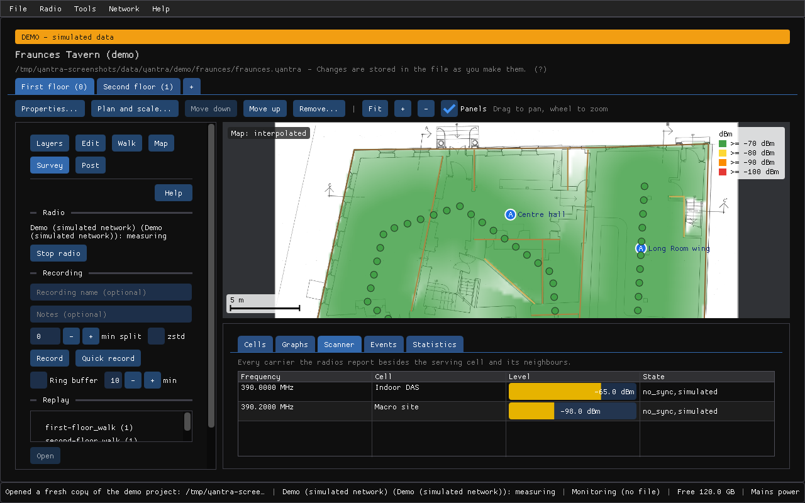

<!--
SPDX-FileCopyrightText: 2026 The Yantra contributors
SPDX-License-Identifier: GPL-3.0-or-later
-->

# 5 Live survey

The survey panels under the plan show what the radio measures now, or the moment of a replay (6.2). They open by themselves when a radio or a replay starts; Panels on the Survey page shows or hides them.

### Watching without a walk

The Survey page of the project window's side panel starts the radio without a walk test: Find radios searches for devices (the radio chosen on the Walk page is used), Start radio measures and fills the panels, Stop radio stops. A walk test (chapter 7) starts the radio by itself. After Stop radio or the end of a walk the radio stays connected, so its windows (chapter 2) keep their device.

## 5.1 Survey panels

The Cells tab shows the large values of the serving cell (level, quality, C1), its identity, channel and frequency, its broadcast parameters, the cell name from the cell database (chapter 8), the floor and the sample counter. The neighbour list shows, in different colours, the neighbours that are announced and received, received only, and announced only. Rest the pointer on a value for its name, unit and source.

 [light theme](../img/survey_light.png)

## 5.2 Graphs

The Graphs tab draws the level, C1 and quality of the serving cell and up to 31 neighbours over the last minutes (the graph span, 15.2), with optional threshold lines from the cell's broadcast parameters. Cells get the colour of the cell database, else one of twelve colours. Clicking or dragging in a graph sets a cursor: every panel then shows that moment; Live follows the newest values again. In a replay the cursor moves the replay.

 [light theme](../img/survey_graphs_light.png)

## 5.3 Scanner, events and statistics

The Scanner tab lists every carrier the radio sees, by frequency, also the ones it cannot decode. Its State column shows the sample flags (for example "no_sync" or "late"); a list too long for the column ends in "..." and shows in full when you hover over it. The Events tab shows serving-cell changes, sync losses, device and recording events and data losses, newest first. The Statistics tab counts serving-cell changes and sync losses, the time in and out of coverage and the share of samples at or above the coverage threshold (the threshold field on the Survey page, also in 15.2).

 [light theme](../img/survey_scanner_light.png)
 [light theme](../img/survey_events_light.png)

The self-interference warning (3.1, "Reference noise and self-interference") shows as a line above the tabs.

## 5.4 The status bar

The status bar shows the last message, the radio's state (or the replay), the recording state, a "Dropped" count in amber when the radio dropped records, the self-interference warning, the free disk space where the project is, and the battery or mains state. Warnings are amber. Dropped records mean the PC did not keep up with the radio: close other programs, lower the radio's sample rate or its records per second.

## 5.5 Sounds and level alerts

Yantra can sound the serving level as a tone at an interval (a higher tone for a stronger level, from -120 to -40 dBm), and give a sound on loss of sync, on a new serving cell and on a low battery. Level alerts watch up to 8 cells (by name, identity or carrier in MHz): when a cell drops below its threshold or is no longer received, a sound and, if you want, a popup tell you, once, until the level has been 2 dB above the threshold again. A sound never cuts off a playing voice note. A replay plays no sounds. Set them up in File > Settings > Sound (15.3).
