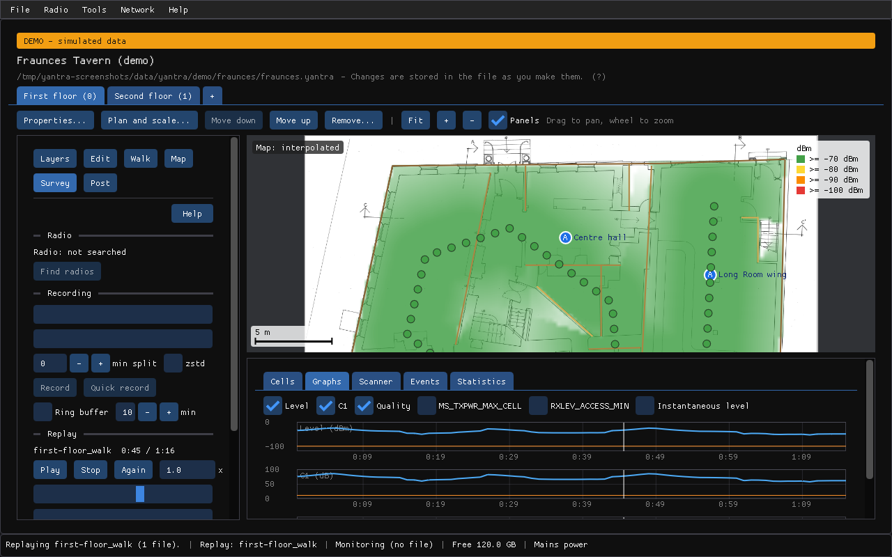
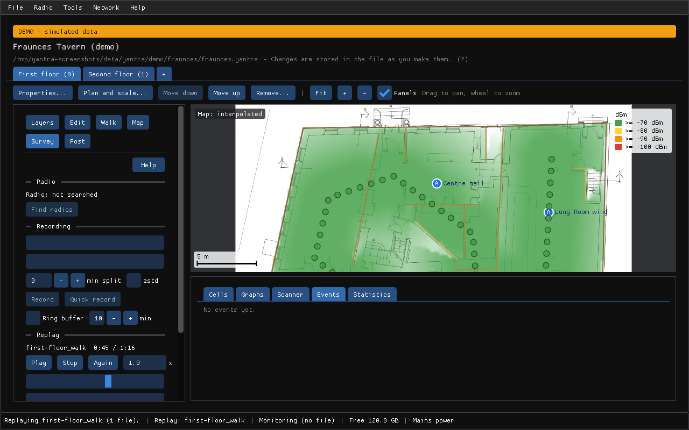

<!--
SPDX-FileCopyrightText: 2026 The Yantra contributors
SPDX-License-Identifier: GPL-3.0-or-later
-->

# 5 Live survey

The Survey page of the project window shows what the radio measures now.

## 5.1 Survey panels

The serving cell panel shows the large values: level, quality, identity, channel and frequency, the cell name from the cell database, the floor and the sample counter. The neighbour panel lists measured and announced neighbours in different colours.

 [light theme](../img/survey_light.png)

## 5.2 Graphs

The level and C1 graphs show the serving cell and up to 31 neighbours over time, with optional threshold lines. Clicking a graph sets a cursor: all panels then show that moment.

 [light theme](../img/survey_graphs_light.png)

## 5.3 Scanner, events and statistics

The scanner lists every carrier the radio sees. The event list shows serving-cell changes, sync losses, device and recording events. The statistics count serving-cell changes, sync losses, time in and out of coverage and the share of samples above the threshold.

 [light theme](../img/survey_scanner_light.png)
 [light theme](../img/survey_events_light.png)

## 5.4 The status bar

The status bar shows free disk space, the battery or power state, the radio's state, the recording state and a warning when records were dropped.

## 5.5 Sounds and level alerts

Yantra can sound the serving level as a tone at an interval (a higher tone for a stronger level), and give a sound on loss of sync, on a new serving cell and on a low battery. Level alerts watch up to 8 cells: when a cell drops below its threshold, a popup and a sound tell you. Set them up in File > Settings > Sound.
