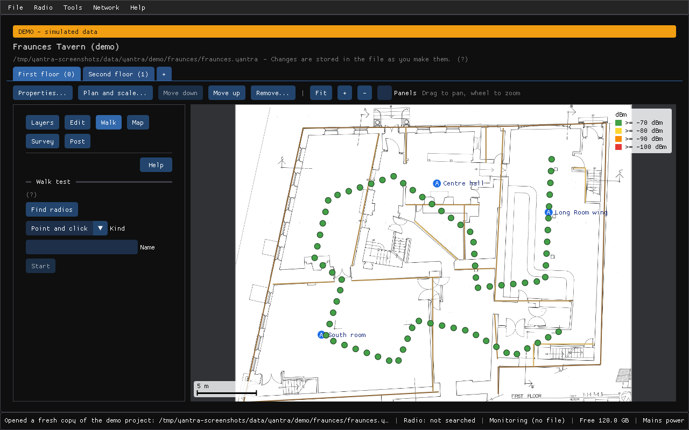

<!--
SPDX-FileCopyrightText: 2026 The Yantra contributors
SPDX-License-Identifier: GPL-3.0-or-later
-->

# 7 Walk tests

A walk test ties the measurements to positions on the floor plan. It belongs to one floor of the project; a floor can have many walk tests, and every walk test keeps its points, its radio, its calibration and a recording (6.1). The floor needs a scale (13.2) for distances, binning and interpolation; points can be placed on a floor without a scale, but they cannot be interpolated.

## 7.1 Walking a floor

On the Walk page of the side panel choose the radio (Search again finds the radios), the kind of walk and its name, then Start. While a walk runs the left mouse button belongs to the walk: the editing tools are off, and middle or right drag still pans the plan. Every measurement cycle (one per second) becomes at most one point. Stop ends the walk test.

The kinds:

- Point and click: click your start point, walk at a steady pace and click where you are at the end of a straight stretch. Yantra spreads the cycles of the stretch evenly along the line between the two clicks. The next click starts a new stretch; cycles before the first click and between an end and the next start get no position.
- Continuous: every click ends the open stretch and starts the next one, so you click at every turn without a gap.
- Manual points: click a spot (a room) and stand there: the cycles of the next few seconds (Seconds per point, 5 by default) become one averaged point at the click. Levels are averaged as power.
- Mouse survey (simulator only, below).

Pause drops the open stretch and its waiting cycles; the next click starts again. Delete last removes the last stretch's points. A walk test belongs to the floor it started on: stop it, choose the next floor's tab and start a new walk test there.

The points are drawn as they come, coloured by the serving level with the legend of the plan; rest the pointer on a point to see its values.

 [light theme](../img/walk_test_light.png)

### Mouse survey

With the simulator as the radio, the Mouse survey kind lets the mouse stand in for you: move it slowly over the plan and the simulator measures where the mouse is, with the walls and antennas of the floor. A point is stored at most every Point spacing (0.25 m by default); above the Speed warning (2 m/s on the plan's scale) the page asks you to move slower. The cycles run five times a second. A click on the plan runs the interpolation of the floor (13.5); Esc or Stop ends the survey.

The simulator reports its levels in dBm by default, so the points are in dBm without any calibration and can be interpolated; the Walk page says "Levels: dBm, as the radio reports them". Yantra applies no automatic or simulated calibration. When you set the simulator's Levels to "dBFS (like an SDR)" (Radio > Settings...), the points are uncalibrated (dBFS) and the Walk page says so, until you calibrate the simulator with the calibration wizard and its simulated signal generator (a practice calibration, 3.1).

## 7.2 Manual points

A manual point measures for a few seconds at one spot you click on the plan: choose Manual points as the kind, set Seconds per point, Start, then click each spot and stand still until the point appears. Use it for rooms you cannot walk through, or for a fixed grid of test points as an acceptance test may ask. Each point averages the cycles of its seconds: levels, C1 and quality in dB as power, other values arithmetically.
