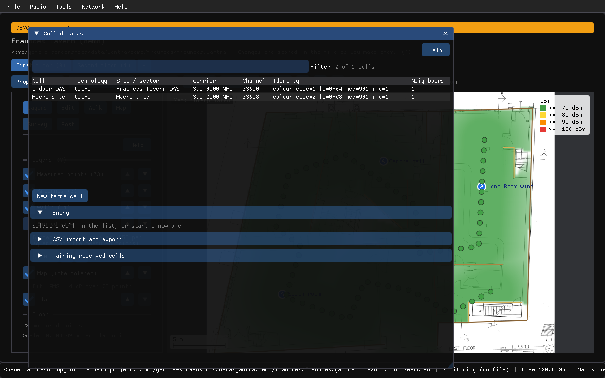
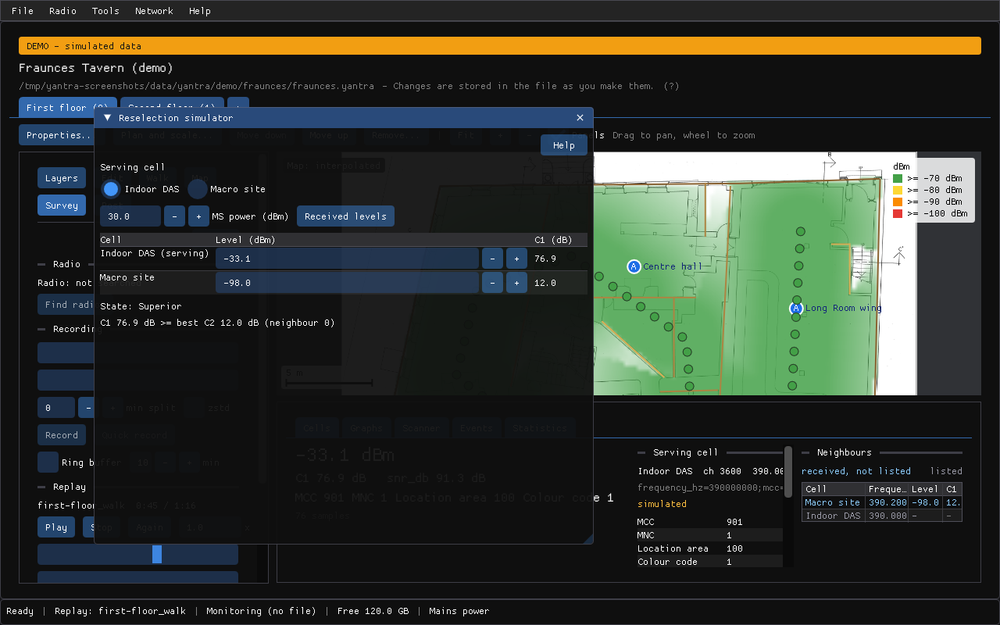

<!--
SPDX-FileCopyrightText: 2026 The Yantra contributors
SPDX-License-Identifier: GPL-3.0-or-later
-->

# 8 Cell database and network analysis

The Network menu holds the cell database and the checks against it.

## 8.1 The cell database

The cell database lists the network's cells with their identity, carrier, site and neighbours. Cells can be edited, imported and exported as CSV and paired with the received cells.

 [light theme](../img/cell_database_light.png)

## 8.2 Verification

Verification compares the cells received during the survey with the database: matches, differences, new cells and cells not seen, and the cross-check of the neighbour lists.

 [light theme](../img/verification_light.png)

## 8.3 Reselection simulator

The reselection simulator computes C1 for a serving cell and its neighbours at the levels you enter or the levels received, and shows which cell the technology's rule chooses.

 [light theme](../img/reselection_light.png)

## 8.4 Calculators of the technology plugins

Technology plugins can add calculators under Tools, for example channel and frequency conversion with duplex spacing.
