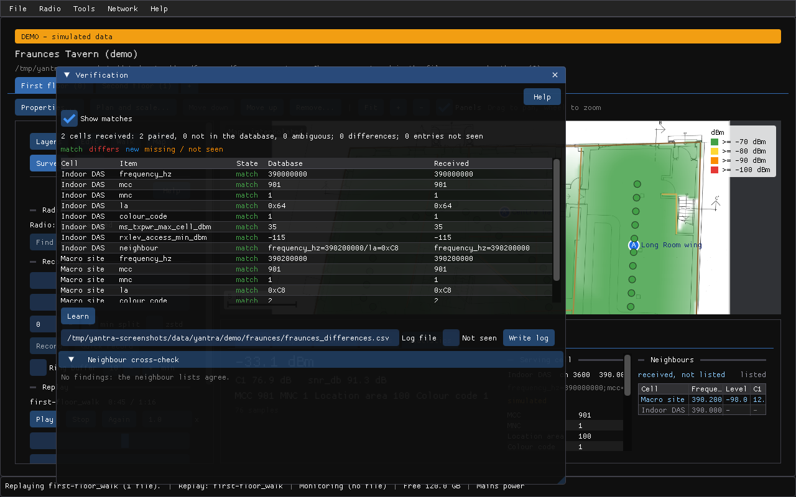

<!--
SPDX-FileCopyrightText: 2026 The Yantra contributors
SPDX-License-Identifier: GPL-3.0-or-later
-->

# 8 Cell database and network analysis

The Network menu holds the cell database and the checks against it; they need an open project, because the cell database belongs to the project. The rules of a technology (which fields identify a cell, the channel raster, how values compare, C1 and reselection) come from its technology plugin, here the TETRA plugin.

## 8.1 The cell database

Network > Cell database... lists the network's cells: name, technology, site and sector, carrier in MHz, channel number, identity (the LA in hexadecimal) and the number of neighbours, with a filter field. New (per technology) starts an entry: the fields that identify the cell and the broadcast parameters to verify (typed as decimal, `0x..` hexadecimal, a number or a text), the label, site, sector, azimuth, colour and notes, and the neighbour list, one neighbour per line as `name=value/name=value` (at most 31). Add field adds another field. Apply stores the whole database in the project; Cancel drops the edit; Remove deletes a cell.

CSV import and export: choose the file, whether the LA is in hexadecimal and whether the separator is a semicolon; with Import replaces ticked the import replaces the database, else it merges into it, and lists the rows it skipped with the reason. The format is in `docs/CELL_DATABASE.md`.

Pairing received cells: received cells are paired with the database by the fields that identify a cell (for TETRA the carrier, MCC, MNC and LA); per technology you can type other fields and press Use. A paired cell shows its name and colour in the panels, graphs and reports.

 [light theme](../img/cell_database_light.png)

## 8.2 Verification

Network > Verification... compares the cells received since the radio or the replay started with the database. It shows the counts, then one row per check: match (green), differs (red), new (blue: received but not in the database) and missing or not seen (amber: in the database but not received). Untick Show matches to see only the findings. Learn adds the new cells and fills fields the entries lack (it never overwrites a value). Write log appends the differences to a CSV file (by default `<project>_differences.csv`, each difference once; optionally also the entries not seen).

The neighbour cross-check looks at the neighbour lists of the database and of the survey together: neighbours that are not mutual, cells whose list is unknown, neighbours never seen and entries that match more than one cell. Verification needs the broadcast parameters as received, so it works on a live radio or a replay; the report (10.2) replays the project's recordings for the same tables.

 [light theme](../img/verification_light.png)

## 8.3 Reselection simulator

Network > Reselection simulator... computes C1 for a serving cell and its neighbours (from the database list) at the levels you type, or at the levels received (Received levels), with the MS maximum power you set, and shows the C1 of every cell, the state of the serving cell, the cell the technology's rule chooses and why. The TETRA rule works on static levels without the standard's timers, so take its answer as a planning aid.

 [light theme](../img/reselection_light.png)

## 8.4 Calculators of the technology plugins

Technology plugins can add calculators under the Tools menu. The TETRA plugin's calculator converts between channel number and frequency (band, carrier offset, duplex spacing and reverse operation, downlink and uplink) and shows the subscriber classes of a class bitmap.
