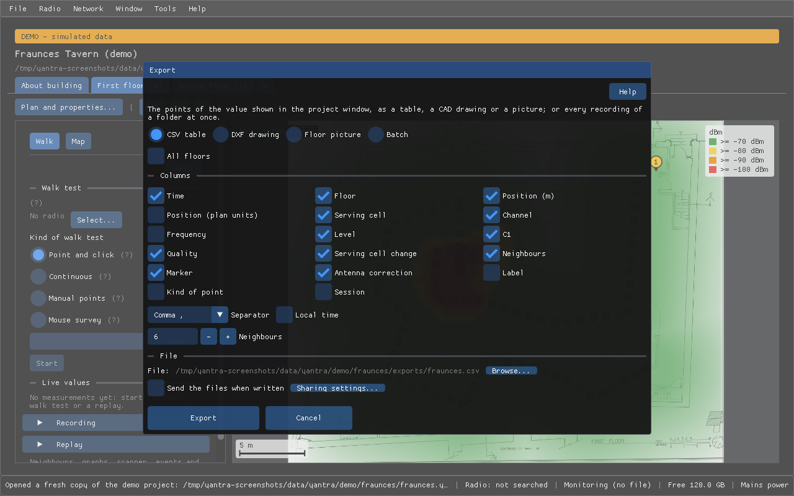
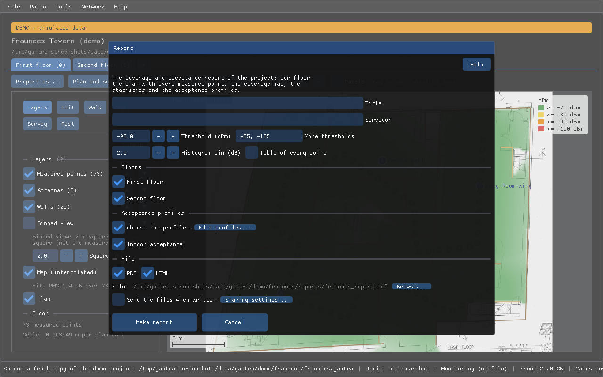

<!--
SPDX-FileCopyrightText: 2026 The Yantra contributors
SPDX-License-Identifier: GPL-3.0-or-later
-->

# 10 Export and reports

Exports and reports use the same points and statistics as the project window: the value it shows (level, C1 or a quality field), its technology filter and its view. File > Export and File > Report need an open project with at least one floor.

## 10.1 Exporting points, drawings and pictures

File > Export writes the points in one of four ways:

- **CSV table**: one row per point with the columns you tick (time, floor, position, serving cell, channel, frequency, level, C1, quality, neighbours, markers and more), the separator (a semicolon suits spreadsheets with a decimal comma) and the time in UTC or in the computer's local time. *All floors* puts every floor into one file; otherwise the floor shown is written.
- **DXF drawing**: the floor's measured points in their colours on their own layers, in metres, for a CAD program. With *All floors* each floor gets its own file.
- **Floor picture**: the plan with the coloured points, the legend and optionally the stored coverage map under the points, as PNG or JPG.
- **Batch**: every recording in a folder and its subfolders, merged into one file or one file per recording, as CSV or in the format of an exporter plugin.

 [light theme](../img/export_light.png)

Files go into the *exports* folder next to the project unless you choose another one with Browse. A batch export runs in the background; the status line says when it is done.

## 10.2 The coverage and acceptance report

File > Report makes the indoor coverage and acceptance report as PDF, HTML or both. Each floor has its own section: the plan with every measured point, the coverage map when one is stored, the statistics, the level histogram, the coverage at the threshold and the further thresholds you type, and the result of each acceptance profile. Type your name as the *Surveyor*: it is printed on the report and never stored. *Table of every point* adds the list of all points of each floor. The report is written in the background into the *reports* folder next to the project. When it is ready, a *Report ready* message lists the files: *Open* shows the report in your system's viewer (the PDF when you wrote both), *Show in folder* opens its folder in your file manager, and *Close* (Esc) just closes the message.

 [light theme](../img/report_light.png)

What the report holds, in order:

- The cover: project, site, network operator, the surveyor, the measurement dates, floors, points and equipment, and the curtat.be reference with its logo (also in the footer of every page).
- The measurement metadata: the radios with driver, serial number and plugin, their calibration status (valid, expired, uncalibrated, or "simulated (practice)" for the simulator calibrated with the wizard, 3.1), the cell database, the plugins and the walk tests per floor. Uncalibrated (dBFS) levels are noted.
- The building summary: every floor's points together and the acceptance profiles over the building with PASS or FAIL. A profile that fails names its weak areas: the measured points below its threshold, grouped where they lie close together, each with its floor and where it is on the plan (a manual point's label when the points have one), its extent in metres, its points and its lowest value.
- One section per floor, as listed above. The share of measured points and the share of the floor area (interpolated) are always given side by side, never mixed.
- The network verification: the cells received in the walks against the cell database, and the neighbour cross-check (chapter 8).

A demo project's report carries the DEMO label. A licence-restricted plan (the MAK sheets of the tour, 1.3) is drawn only from your own cached copy, with its credit and licence under the picture; without the cached copy the report leaves the plan out.

A [sample report](../samples/fraunces_report.pdf) of the demo project shows the result. Its verdict is FAIL: the stairwell in the middle of the Fraunces first floor is a weak area, named in the building summary; the MAK example buildings of the tour pass.

## 10.3 Acceptance profiles

An acceptance profile passes when enough of the floor reaches each level, for example 95 % at -95 dBm. Its basis says what is counted: the measured points, the tested area (the walked squares, each with the percentile you choose) or the floor area of the interpolated map (only cells with at least the confidence you choose). Edit profiles in the Report dialog adds, changes and removes the project's profiles; a profile with a problem shows it in red and is not stored. Without stored profiles the report uses the default one. *Choose the profiles* limits the report to the ticked ones.

## 10.4 Sending exports and reports

Tick *Send the files when written* in the Export or Report dialog to send the files when they are ready. Sharing settings chooses how:

- **Shared folder**: the files are copied into a mounted network folder.
- **Upload (HTTP)**: each file is sent with an HTTP PUT to the address followed by the file name, for a WebDAV folder or your own upload service.
- **E-mail (SMTP)**: one e-mail with the files attached, through your own mail server.

The password is kept until Yantra closes and never stored. With *Send the floor's CSV when a walk test ends* the floor's points are exported and sent by themselves each time a walk test stops. Nothing is sent unless you choose a method.
