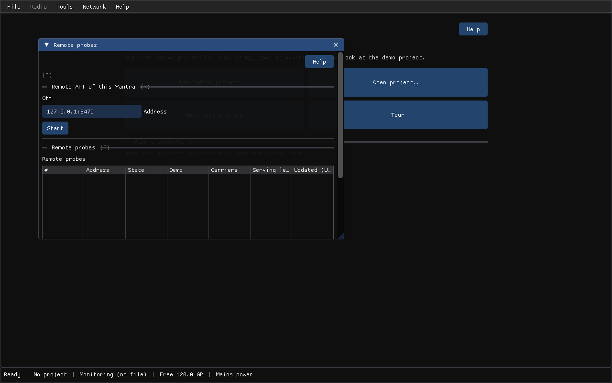

<!--
SPDX-FileCopyrightText: 2026 The Yantra contributors
SPDX-License-Identifier: GPL-3.0-or-later
-->

# 12 Automation

Yantra can run without a window, be controlled from scripts and from another computer, and log on its own for days. All of this comes from the probe plugin (`probe.so`) and the headless runner `yantra-probe`. Without the probe plugin, or with it switched off in the plugin manager (chapter 14), Yantra opens no network connection for it at all.

## 12.1 The headless probe

`yantra-probe` runs the measurement of Yantra without a window, with the same radios, plugins, calibration and recordings as the app. `yantra-probe --demo` measures the built-in simulator; `yantra-probe --radio <plugin>` a radio plugin, and `--record` starts recording at once. It reads one command per line on its standard input and answers each with one line of JSON: `status`, `record start <name>`, `record stop`, `monitor on`, `monitor off`, `play file=<recording>`, `sound on`, `sound off`, `rotate` and `quit` (`yantra-probe commands` lists them all). It stops cleanly on `quit`, Ctrl+C or a stop signal and closes a running recording first.

## 12.2 The remote API

The probe plugin serves the same commands, the probe's status, cells, neighbours, levels, summaries and recordings over HTTP, and a filtered live view (cell information, levels and quality only) over a WebSocket. The server stays off until you give it an address: `yantra-probe --api 127.0.0.1:8470`, or Start in the Remote probes window (12.3). Every request except the version information needs a token: the owner token (full control) is written on the first start into a token file only you can read; an optional LAN token allows reading only, from local networks. Five wrong tokens block an address for a minute. There is no built-in encryption: for anything other than this computer, put the API behind an HTTPS reverse proxy or an SSH tunnel. The developer reference is `docs/API.md`.

## 12.3 Remote probes

Tools > Remote probes shows this Yantra's own API (off, or its port and token file, with Start and Stop) and the other probes it follows: add a probe with its address (`http://host:port`) and its owner or LAN token, and the table shows each probe's state, demo mark, carriers, serving level and when it last answered, read every two seconds. Remove takes a probe off the list by its number. In the app, remote clients may start and stop recording and monitoring and switch the sound; replaying and quitting are only for `yantra-probe`.

 [light theme](../img/remote_probes_light.png)

## 12.4 Unattended fixed probe

For long-term logging, `yantra-probe --record --split-minutes 60 --keep 168 --compress` starts a new recording file every hour, keeps the newest 168 and writes them compressed (zstd). Every minute the probe plugin writes a health summary (state, radio, recording, counters, last error) and every five minutes a coverage summary per carrier (records, synchronised records, minimum, maximum and mean level) to its data folder; both are also served by the API and pushed to live clients. Nothing is sent anywhere unless a client asks for it.
