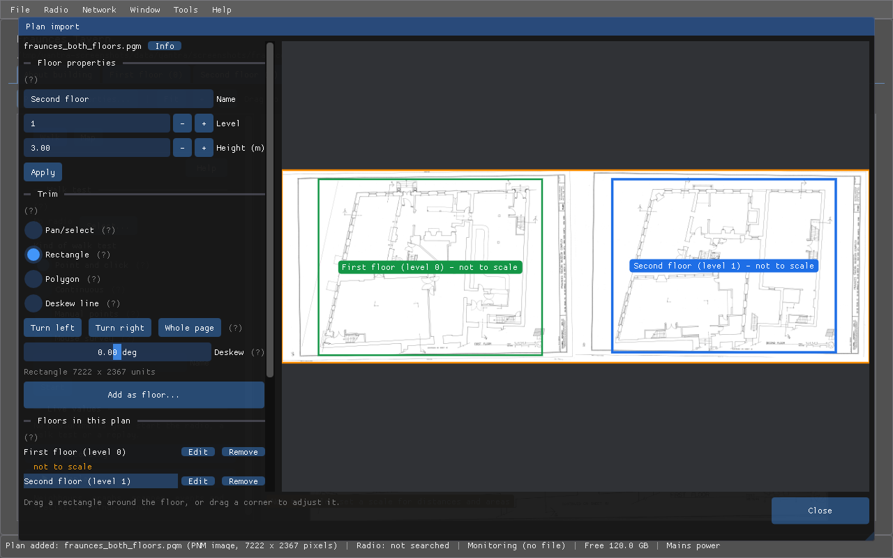
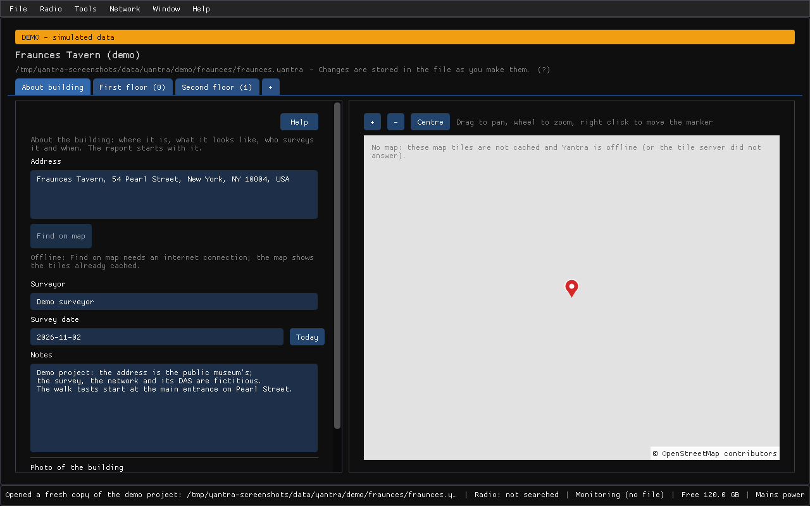

<!--
SPDX-FileCopyrightText: 2026 The Yantra contributors
SPDX-License-Identifier: GPL-3.0-or-later
-->

# 13 Indoor projects

A project is one building: its floors with their plans, the cell database, the walk tests with their points, the stored coverage maps and the acceptance profiles. It is one file (`*.yantra`); recordings, exports and reports go into folders next to it. The [first indoor project](../quickstart/01-first-indoor-project.md) quick start goes through the whole chain in one page.

The same eight seconds as [WebM](../img/indoor_workflow.webm): the start screen, the plan import, a walk test's points, the coverage map and the report dialog, on the demo project.

### The project window

An open project shows the plan of one floor, the floor tabs above it and two tabs beside it, for the two parts of the work:

- Walk: measure. The radio in use with Select... (it opens Radio > Radios..., chapter 2), Start radio and Stop radio, the live values of the serving cell with a small level graph (chapter 5), the walk test with its kind (radio buttons, each with a "(?)") and Start, Pause, Delete last and Stop (chapter 7), the Recording and Replay sections, closed until you open them (chapter 6).
- Map: look at the result. The Show row switches the plan, the measured points and the coverage map on and off, with the map's opacity (13.4); Compute map makes the floor's map (13.5). The Advanced dropdown holds the rest: the interpolation settings, the binned squares, the post-processing views of the points (chapter 11) and the acceptance check (11.2).

The menus hold what is not part of the walk: File (projects, floors, File > Export and File > Report, chapter 10, Settings), Radio (the radios and their windows, chapter 2), Network (the cell database and the checks against it, chapter 8), Window (the survey windows Neighbours, Graphs, Scanner, Events and Statistics, chapter 5; each item opens or closes its window) and Help.

## 13.1 Projects and floors

File > New indoor project asks for the project name, the site, the network operator, notes and where to save the file. File > Open project and the recent projects on the start screen open one; a project open in another Yantra is refused with the reason. Changes are stored in the file as you make them, so there is no "unsaved changes" question and a crash loses nothing: File > Save only makes the file complete on its own (for copying), Save as writes a copy under a new name, and Close project closes it. A project of an older Yantra is converted when it opens, after a backup copy (`<file>.schema<N>.bak`); a project of a newer Yantra is refused. The project file names the files it refers to (recordings, a licence-restricted plan in your cache) relative to its own folder when they are on the same drive, so you can move or share the project folder with its recordings; Save as into another folder keeps naming the same files. Projects of Yantra 0.1, which name them with full paths, still open.

File > Add floor adds a floor in one of three ways: from a new plan file (PDF or image; Choose a plan file...), from a plan already in the project (another floor of the same sheet, Use), or as a blank floor without a plan. A new plan opens the plan import window (13.2).

The floor tabs above the plan switch between floors, ordered by level; the tooltip of a tab gives its points and scale. Drag a floor tab to its place to change the order of the floors (their levels follow); a right click on a tab opens its menu with Move down and Move up (one place) and Remove..., which deletes the floor after a question that lists its walk tests and points (the recordings stay on disk). Plan and properties... opens the plan import window again for the floor's sheet, with the floor selected and its name, level and floor-to-floor height at the top of the panel (Floor properties; Apply stores them and the window stays open). For a floor without a plan it opens just the floor's name, level and height. Fit, zoom in and zoom out frame the plan; drag pans, the mouse wheel zooms and a double click fits.

## 13.2 Plan import and trimming

The plan import window shows the sheet (choose the page of a PDF) and cuts the floors out of it, so one sheet can give several floors. The panel on the left starts with the file name; Info next to it shows the file's type, page, size and resolution, and for a licence-restricted example plan its title, credit, licence, source link and notes (closed until you press Info). Every option has a "(?)" that explains it when you rest the pointer on it or click it. The trim tools come first, then Add as floor..., the list of floors in this plan and the preview of the trim; Scale and Alignment are closed until you open them with their arrow. The tools:

- Pan/select: drag to move the sheet; click a floor's outline to select it.
- Rectangle: drag a rectangle around one floor; drag a corner to adjust it.
- Polygon: click the corners of an irregular outline; click the first point or Finish (Enter) to close it; Undo point (Backspace) and Esc.
- Deskew: drag along a wall or the sheet's border that should be straight; the plan turns so it is. Turn left and Turn right turn it by 90 degrees; Whole page resets the trim.
- Scale line (in Scale): drag between two points whose real distance you know, type the distance in metres and Apply.
- Scale bar (in Scale): drag along the plan's scale bar end to end, type its length and Apply. When the page has a paper size (a PDF, or an image with its resolution), you can also type the drawing scale as 1:N.
- Reference (in Alignment): click a point found on every floor (a staircase corner) to line the floors up above each other.

Add as floor... asks in a popup for the floor's name, level and height; Add adds the trim as that floor, Cancel adds nothing. The window stays open for the next floor. The floors of this sheet are listed: Edit changes a trim (points move with it, so they stay on the same spot of the plan), Remove deletes the floor after a question. Floors of the same sheet can share one scale. Not to scale removes the scale; a floor without a scale can be drawn on, but has no distances, binning or interpolation.

The plan file is copied into the project, unchanged: trims and drawings are applied when the plan is shown, never to the file. Licence-restricted plans (the MAK sheets of the tour, 1.3) are recognised by their SHA-256 and kept as a reference to your cached copy instead, with their credit, licence and the note that the scale is approximate.

 [light theme](../img/plan_import_light.png)

## 13.3 Projects of Yantra 0.2 and earlier

This version of Yantra has no walls, antennas or propagation model: the coverage map comes from the measured points alone (13.5). A project file of Yantra 0.2 or earlier (project schema 7 or lower) still opens. Its walls, wall classes, antennas and ray-tracing maps are left out, a copy of the old file is kept next to it (`<file>.schema<N>.bak`), and a note says so once. Its floors, plans, scales, walk tests and points stay as they were; run the interpolation again to get the floor's map.

## 13.4 Layers

The Show row of the Map tab shows or hides the plan, the measured points and the map, with the map's opacity; the binned squares are switched on in its Advanced dropdown. The binned layer groups the points into squares of the size you set (Square, 2 m by default), each with the percentile of its points (11.1); it is labelled as binned and never replaces the points. The map's opacity (85 % by default) sets how much of the plan shows through it. The layers are always drawn in the same order, from the bottom: the plan, the map, the binned squares and the points on top. When several coverage maps are stored, choose the one to show. The layer settings are kept for the next start; they are not part of the project.

## 13.5 Interpolation

The Map tab computes a coverage map of the floor from its measured points: Compute map starts it in the background (with a progress bar; Cancel stops it), and the map is stored in the project. A floor needs a scale and measured points in dBm (from a calibrated radio or one that reports dBm, such as the simulator, 7.1). In a mouse survey, a click on the plan runs it too.

How it works, in short: the floor is divided into squares of 0.5 m. A square that holds measured points takes their level (the median when there are several), so the map equals the measurement where you measured. Every other square takes the mean of the points within 10 m, each weighted by one over its distance squared (inverse-distance weighting, IDW); the Map tab says "IDW of N measured points". Every square gets a confidence that is 1 within 2 m of a measured point and fades to 0 at 10 m, so unmeasured areas fade out on the plan; squares with no point within 10 m stay empty. The map knows nothing about walls: walk both sides of a wall that matters. The [interpolation note](../INTERPOLATION.md) gives the details and the limits.

The map is always labelled "interpolated" and kept apart from the measured points: the hover readout says whether the value is measured or interpolated, with the confidence and the nearest measured point. When the floor's scale or its points change after a run, the map is marked stale; Compute again computes it again. Settings... (in the Advanced dropdown) sets the grid size, the power, the search radius and the full-confidence distance; Defaults puts them back.

 [light theme](../img/interpolation_light.png)

## 13.6 About building

 [light theme](../img/about_building_light.png)

The first tab of every project, About building, is about the building as a whole; it cannot be removed or moved (the floor tabs after it can be dragged). It holds:

- **Address**: free text, as you would write it on a letter. **Find on map** looks it up on OpenStreetMap (Nominatim) and puts the marker there. Only the address is sent, only when you press the button, once per press; Yantra identifies itself as "Yantra/<version>" and sends nothing else.
- **Map**: an OpenStreetMap map of the building's position. Drag to pan, use the mouse wheel or + and - to zoom, Centre to go back to the marker. Right click on the map for **Move the marker here** (when the search found a place nearby) or **Remove the marker**. The map tiles are fetched only while the map is shown and are kept in your cache folder (`~/.cache/yantra/tiles/osm`, on Windows `%LOCALAPPDATA%\yantra\tiles\osm`; `YANTRA_TILE_CACHE` sets another one), so the map works offline with the tiles seen before; without them it says "No map". The attribution "© OpenStreetMap contributors" is always shown with the map (map data under the ODbL).
- **Photo of the building**: **Open photo...** copies a picture file (JPEG, PNG, BMP, GIF and the other formats Yantra reads for plans, not PDF) into the project; **Take photo...** opens the camera window: choose the camera, look at the preview and press **Take**. Yantra reads the camera itself (V4L2 on Linux, Media Foundation on Windows); when no camera is found it says so. **Remove photo** takes it out of the project.
- **Surveyor**, **Survey date** (YYYY-MM-DD; a new project starts with the day it was made, **Today** sets today) and **Notes** (several lines).

Every field is written to the project file when you leave it, like every other change of a project. The report starts with this information (10.2): the address and position, the map made of the cached tiles (with the attribution), the photo, the surveyor, the date and the notes. Nothing of it leaves the computer except the address search and the map tiles you ask for by showing the map.
