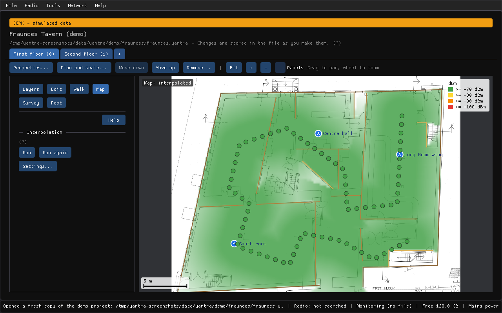

<!--
SPDX-FileCopyrightText: 2026 The Yantra contributors
SPDX-License-Identifier: GPL-3.0-or-later
-->

# 13 Indoor projects

A project is one building: its floors with their plans, walls and antennas, the cell database, the walk tests with their points, the stored coverage maps and the acceptance profiles. It is one file (`*.yantra`); recordings, exports and reports go into folders next to it. The [first indoor project](../quickstart/01-first-indoor-project.md) quick start goes through the whole chain in one page.

The same eight seconds as [WebM](../img/indoor_workflow.webm): the start screen, the plan import, a walk test's points, the coverage map and the report dialog, on the demo project.

## 13.1 Projects and floors

File > New indoor project asks for the project name, the site, the network operator, notes and where to save the file. File > Open project and the recent projects on the start screen open one; a project open in another Yantra is refused with the reason. Changes are stored in the file as you make them, so there is no "unsaved changes" question and a crash loses nothing: File > Save only makes the file complete on its own (for copying), Save as writes a copy under a new name, and Close project closes it. A project of an older Yantra is converted when it opens, after a backup copy (`<file>.schema<N>.bak`); a project of a newer Yantra is refused.

File > Add floor adds a floor in one of three ways: from a new plan file (PDF or image; Choose a plan file...), from a plan already in the project (another floor of the same sheet, Use), or as a blank floor without a plan. A new plan opens the plan import window (13.2).

The floor tabs above the plan switch between floors, ordered by level; the tooltip of a tab gives its points and scale. Properties... sets the floor's name, level and floor-to-floor height; Move up and Move down swap its level with the next floor; Remove... deletes the floor after a question that lists its walls, antennas, walk tests and points (the recordings stay on disk). Plan and scale... opens the plan import window again for the floor's sheet. Fit, zoom in and zoom out frame the plan; drag pans, the mouse wheel zooms and a double click fits.

## 13.2 Plan import and trimming

The plan import window shows the sheet (choose the page of a PDF) and cuts the floors out of it, so one sheet can give several floors. The tools:

- Pan/select: drag to move the sheet; click a floor's outline to select it.
- Rectangle: drag a rectangle around one floor; drag a corner to adjust it.
- Polygon: click the corners of an irregular outline; click the first point or Finish (Enter) to close it; Undo point (Backspace) and Esc.
- Deskew: drag along a wall or the sheet's border that should be straight; the plan turns so it is. Turn left and Turn right turn it by 90 degrees; Whole page resets the trim.
- Scale line: drag between two points whose real distance you know, type the distance in metres and Apply.
- Scale bar: drag along the plan's scale bar end to end, type its length and Apply. When the page has a paper size (a PDF, or an image with its resolution), you can also type the drawing scale as 1:N.
- Reference: click a point found on every floor (a staircase corner) to line the floors up above each other.

Add as floor... adds the trim as a floor with its name, level and height; the window stays open for the next floor. The floors of this sheet are listed: Edit changes a trim (walls, antennas and points move with it, so they stay on the same spot of the plan), Remove deletes the floor after a question. Floors of the same sheet can share one scale. Not to scale removes the scale; a floor without a scale can be drawn on, but has no distances, binning or interpolation.

The plan file is copied into the project, unchanged: trims and drawings are applied when the plan is shown, never to the file. Licence-restricted plans (the MAK sheets of the tour, 1.3) are recognised by their SHA-256 and kept as a reference to your cached copy instead, with their credit, licence and the note that the scale is approximate.

 [light theme](../img/plan_import_light.png)

## 13.3 Walls and antennas

The Edit page draws the building model of the shown floor. The tools (with their keys):

- Pan (P): look around without changing anything.
- Select (S): click a wall, a wall corner or an antenna to select it and drag to move it; a double click on the selected wall adds a corner, Split cuts a wall at a corner, Delete removes the selection.
- Draw wall (W): click the corners of a wall; double click or Enter ends it, Backspace removes the last corner, Esc drops it. Corners snap to the corners of other walls. New walls get the class chosen under New walls.
- Place antenna (A): click to place an antenna, then set its properties.
- Aim: click where the selected directional antenna points, or the direction of an outdoor donor site.

A selected wall has its class and, if you want, its own attenuation in dB. Classes... edits the wall classes: each class has a loss per frequency band (for example concrete, brick, plasterboard, glass), with defaults from published ranges; a class in use cannot be removed, and Reset defaults puts the defaults back. The antenna properties: name, model, height, gain, pattern, azimuth and beamwidth (directional antennas), front-to-back ratio and direction, the EIRP when it is known, the cable loss, the cell it serves (or a new cell), and whether it is an outdoor donor or macro direction rather than an indoor antenna. Undo and Redo (Ctrl+Z, Ctrl+Y) step through the edits of the floor.

### Propose walls

Propose walls looks for long straight dark lines on a floor's plan and shows them dashed and numbered. It needs a plan picture and a scale. The search runs in the background and can be cancelled. Shortest wall sets the shortest line it proposes (1.5 m by default). Lines close to an existing wall are left out. Accept a proposal and it becomes an ordinary wall of the class chosen under New walls, which you can edit and undo like any other; Accept all and Reject all take the whole list. Reject it and it is forgotten. Nothing is stored in the project until you accept it, and changing floor forgets the list. Dimension lines, furniture and text can be proposed too, so check each one against the plan.

## 13.4 Layers

The Layers page shows or hides the plan, the interpolation, the binned squares, the walls, the antennas and the points, and sets their drawing order with the arrows. The binned layer groups the points into squares of the size you set (Square, 2 m by default), each with the percentile of its points (11.1); it is labelled as binned and never replaces the points. When several coverage maps are stored, choose the one to show. The layer settings are kept for the next start; they are not part of the project.

## 13.5 Interpolation

The Map page fits the propagation model to the measured points of the floor and computes a coverage map: Run starts it in the background (with a progress bar; Cancel stops it), and the map is stored in the project. A floor needs a scale and measured points in dBm (calibrated, or the practice calibration of the mouse survey, 7.1). In a mouse survey, a click on the plan runs it too.

How it works, in short: a ray tracer predicts the level of every antenna over the floor through the walls drawn (with reflections), the model is fitted to the measured points (antenna power, wall losses), the differences that remain at the points are spread over the floor (limited by walls), and every spot gets a confidence that fades from 1 within 2 m of a measured point to 0 beyond 10 m. Unmeasured areas therefore fade out on the plan. When no antenna of the building reaches the floor, Yantra estimates sources from the points and draws them dashed with their fitted power, labelled "estimated sources". The [measurement method note](../METHOD.md) gives the details and the limits of the model.

The map is always labelled "interpolated" and kept apart from the measured points: the hover readout says whether the value is measured or interpolated, with the model value, the confidence and the nearest measured point. When the walls, antennas or points change after a run, the map is marked stale; Run again computes it again. Settings... sets the propagation parameters: grid size, reflections (0 to 3), path-loss exponent, reference distance, reflection loss, receiver height, default EIRP, whether antennas on other floors count and the attenuation per floor; Defaults puts them back.

 [light theme](../img/interpolation_light.png)
