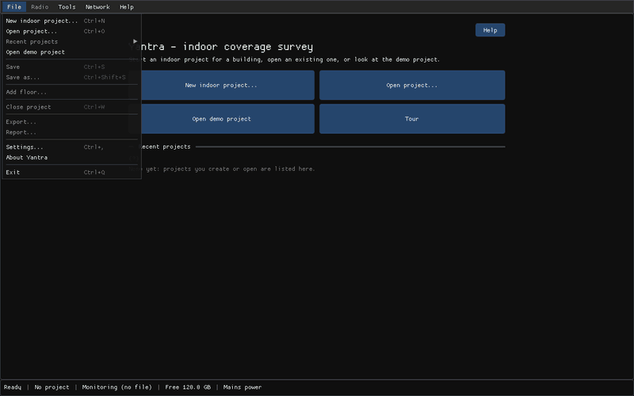

<!--
SPDX-FileCopyrightText: 2026 The Yantra contributors
SPDX-License-Identifier: GPL-3.0-or-later
-->

# 13 Indoor projects

A project is one building: its floors with their plans, the cell database, the walk tests with their points, the stored coverage maps and the acceptance profiles. It is one file (`*.yantra`); recordings, exports and reports go into folders next to it. The [first indoor project](../quickstart/01-first-indoor-project.md) quick start goes through the whole chain in one page.

The same eight seconds as [WebM](../img/indoor_workflow.webm): the start screen, the plan import, a walk test's points, the coverage map and the report dialog, on the demo project.

## 13.1 Projects and floors

File > New indoor project asks for the project name, the site, the network operator, notes and where to save the file. File > Open project and the recent projects on the start screen open one; a project open in another Yantra is refused with the reason. Changes are stored in the file as you make them, so there is no "unsaved changes" question and a crash loses nothing: File > Save only makes the file complete on its own (for copying), Save as writes a copy under a new name, and Close project closes it. A project of an older Yantra is converted when it opens, after a backup copy (`<file>.schema<N>.bak`); a project of a newer Yantra is refused. The project file names the files it refers to (recordings, a licence-restricted plan in your cache) relative to its own folder when they are on the same drive, so you can move or share the project folder with its recordings; Save as into another folder keeps naming the same files. Projects of Yantra 0.1, which name them with full paths, still open.

File > Add floor adds a floor in one of three ways: from a new plan file (PDF or image; Choose a plan file...), from a plan already in the project (another floor of the same sheet, Use), or as a blank floor without a plan. A new plan opens the plan import window (13.2).

The floor tabs above the plan switch between floors, ordered by level; the tooltip of a tab gives its points and scale. Properties... sets the floor's name, level and floor-to-floor height; Move up and Move down swap its level with the next floor; Remove... deletes the floor after a question that lists its walls, antennas, walk tests and points (the recordings stay on disk). Plan and scale... opens the plan import window again for the floor's sheet. Fit, zoom in and zoom out frame the plan; drag pans, the mouse wheel zooms and a double click fits.

## 13.2 Plan import and trimming

The plan import window shows the sheet (choose the page of a PDF) and cuts the floors out of it, so one sheet can give several floors. The tools:

- Pan/select: drag to move the sheet; click a floor's outline to select it.
- Rectangle: drag a rectangle around one floor; drag a corner to adjust it.
- Polygon: click the corners of an irregular outline; click the first point or Finish (Enter) to close it; Undo point (Backspace) and Esc.
- Deskew: drag along a wall or the sheet's border that should be straight; the plan turns so it is. Turn left and Turn right turn it by 90 degrees; Whole page resets the trim.
- Scale line: drag between two points whose real distance you know, type the distance in metres and Apply.
- Scale bar: drag along the plan's scale bar end to end, type its length and Apply. When the page has a paper size (a PDF, or an image with its resolution), you can also type the drawing scale as 1:N.
- Reference: click a point found on every floor (a staircase corner) to line the floors up above each other.

Add as floor... adds the trim as a floor with its name, level and height; the window stays open for the next floor. The floors of this sheet are listed: Edit changes a trim (points move with it, so they stay on the same spot of the plan), Remove deletes the floor after a question. Floors of the same sheet can share one scale. Not to scale removes the scale; a floor without a scale can be drawn on, but has no distances, binning or interpolation.

The plan file is copied into the project, unchanged: trims and drawings are applied when the plan is shown, never to the file. Licence-restricted plans (the MAK sheets of the tour, 1.3) are recognised by their SHA-256 and kept as a reference to your cached copy instead, with their credit, licence and the note that the scale is approximate.

 [light theme](../img/plan_import_light.png)

## 13.3 Projects of Yantra 0.3 and earlier

Yantra 0.4 has no walls, antennas or propagation model: the coverage map comes from the measured points alone (13.5). A project file of Yantra 0.3 or earlier still opens. Its walls, wall classes, antennas and ray-tracing maps are left out, a copy of the old file is kept next to it (`<file>.schema<N>.bak`), and a note says so once. Its floors, plans, scales, walk tests and points stay as they were; run the interpolation again to get the floor's map.

## 13.4 Layers

The Layers page shows or hides the plan, the interpolation, the binned squares and the points, and sets their drawing order with the arrows. The binned layer groups the points into squares of the size you set (Square, 2 m by default), each with the percentile of its points (11.1); it is labelled as binned and never replaces the points. When several coverage maps are stored, choose the one to show. The layer settings are kept for the next start; they are not part of the project.

## 13.5 Interpolation

The Map page computes a coverage map of the floor from its measured points: Run starts it in the background (with a progress bar; Cancel stops it), and the map is stored in the project. A floor needs a scale and measured points in dBm (from a calibrated radio or one that reports dBm, such as the simulator, 7.1). In a mouse survey, a click on the plan runs it too.

How it works, in short: the floor is divided into squares of 0.5 m. A square that holds measured points takes their level (the median when there are several), so the map equals the measurement where you measured. Every other square takes the mean of the points within 10 m, each weighted by one over its distance squared (inverse-distance weighting). Every square gets a confidence that is 1 within 2 m of a measured point and fades to 0 at 10 m, so unmeasured areas fade out on the plan; squares with no point within 10 m stay empty. The map knows nothing about walls: walk both sides of a wall that matters. The [interpolation note](../INTERPOLATION.md) gives the details and the limits.

The map is always labelled "interpolated" and kept apart from the measured points: the hover readout says whether the value is measured or interpolated, with the confidence and the nearest measured point. When the floor's scale or its points change after a run, the map is marked stale; Run again computes it again. Settings... sets the grid size, the power, the search radius and the full-confidence distance; Defaults puts them back.

 [light theme](../img/interpolation_light.png)
