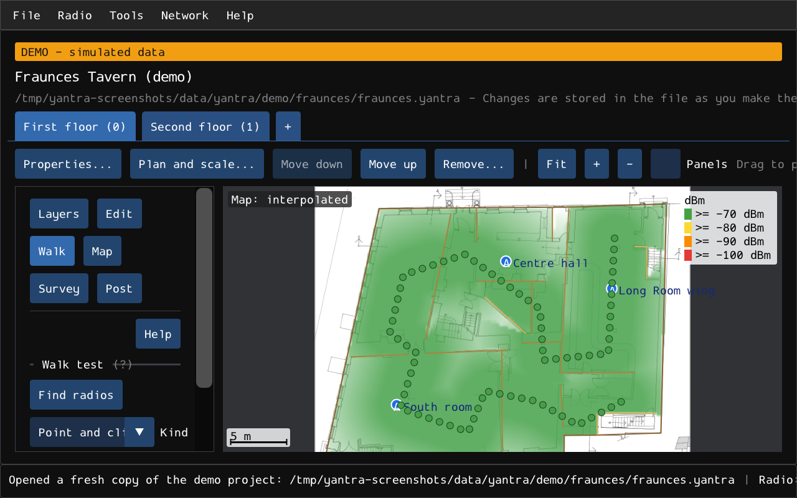
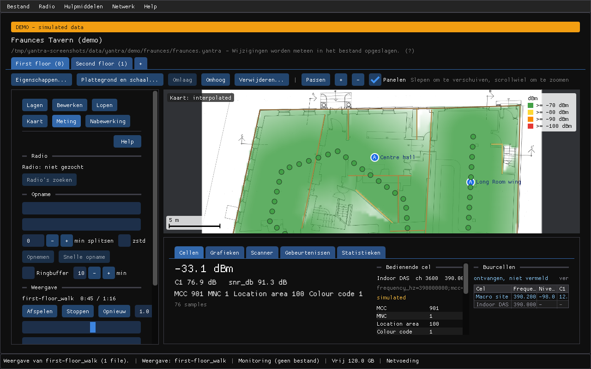
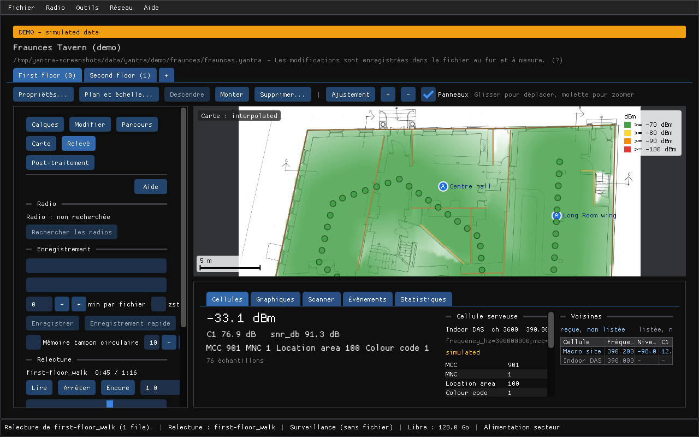
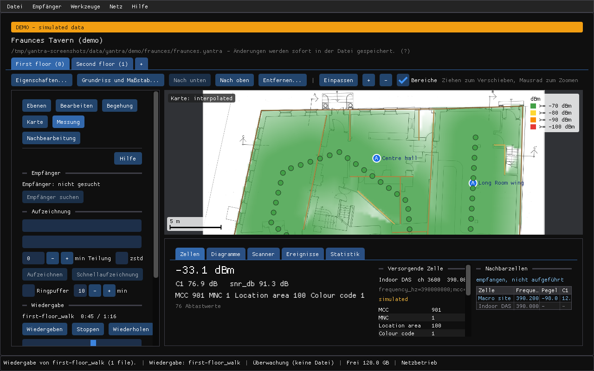
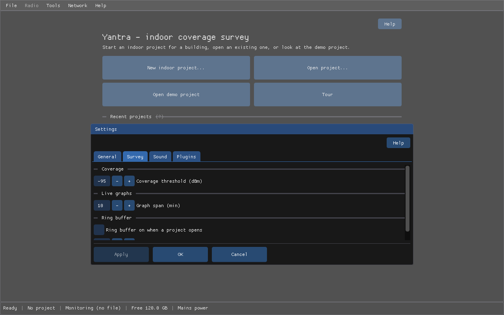
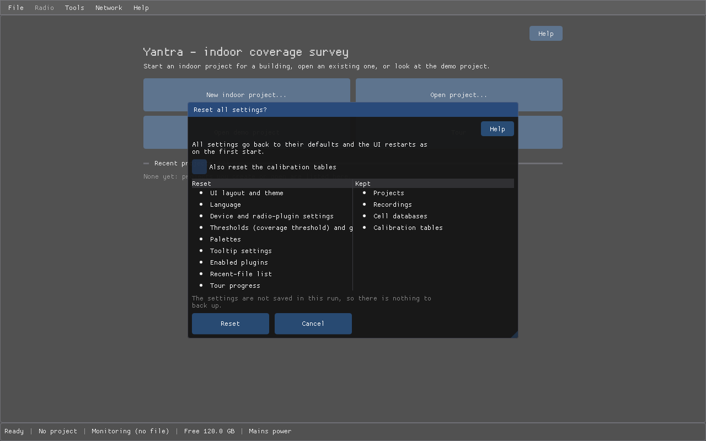

<!--
SPDX-FileCopyrightText: 2026 The Yantra contributors
SPDX-License-Identifier: GPL-3.0-or-later
-->

# 15 Settings and reset

File > Settings (Ctrl+,) holds the settings; they are kept in your user folder.

## 15.1 General settings

The language (English, Dutch, French, German), the theme (dark, light, high contrast), the touch layout with controls of at least 48 pixels for tablets, the UI scale, the tooltips and their delay, and the window system.

 [light theme](../img/touch_light.png)
 [light theme](../img/survey_nl_light.png)
 [light theme](../img/survey_fr_light.png)
 [light theme](../img/survey_de_light.png)

## 15.2 Survey settings

The coverage threshold, the span of the live graphs and the ring buffer that is on when a project opens.

 [light theme](../img/settings_survey_light.png)

## 15.3 Sound settings

Sounds on or off, the volume, the level tone and its interval, sounds for loss of sync, a new serving cell and a low battery, and the level alerts with their cells and thresholds.

## 15.4 Reset all settings

Help > Reset all settings sets every setting back to its default after saving a time-stamped backup. Projects, recordings and cell databases are kept; the calibration tables only when you tick the box. The command line option --reset-settings does the same.

 [light theme](../img/reset_settings_light.png)
