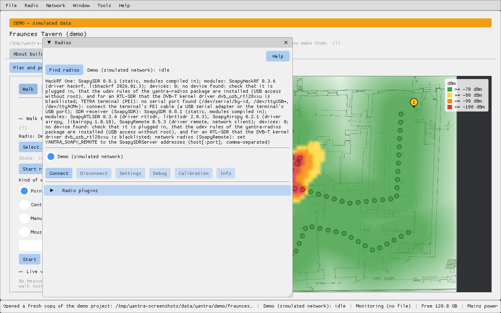
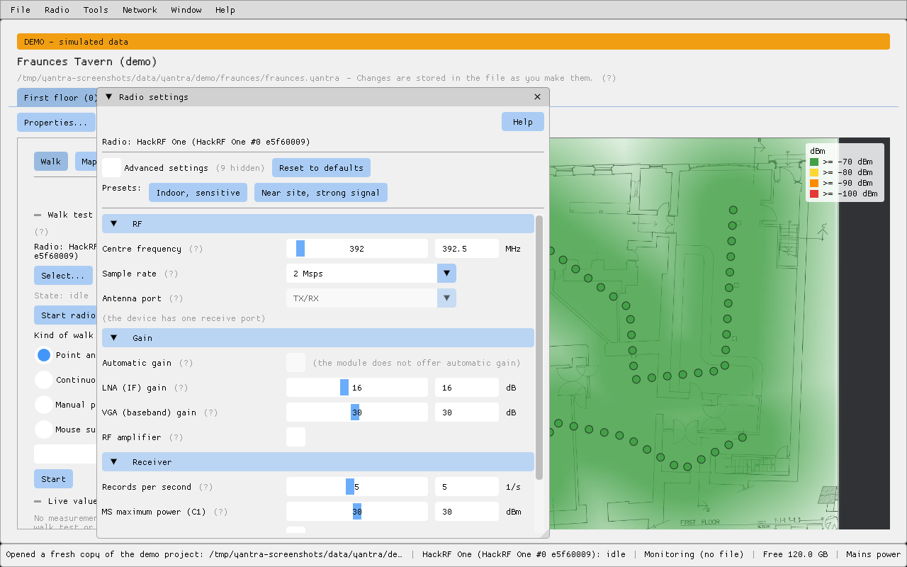
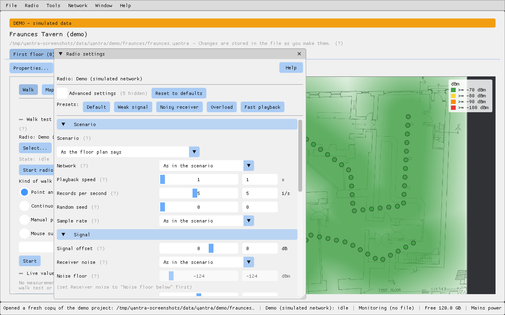

<!--
SPDX-FileCopyrightText: 2026 The Yantra contributors
SPDX-License-Identifier: GPL-3.0-or-later
-->
# About the radio plugins

yantra-radios holds the radio plugins of **Yantra**, an open-source
indoor TETRA coverage survey tool. A radio plugin talks to its own device
(an SDR, a TETRA terminal on a serial port, or a simulator), processes its
own IQ samples and gives Yantra **measurement records only**: level, cell
identity, optional quality, C1, broadcast parameters and neighbours. No IQ
samples, bursts or PDUs reach Yantra.

The plugins are receive-only. They decode what every TETRA base station
broadcasts in the clear (synchronisation, system information, neighbour
lists) and measure levels and quality. They do not decode speech, short
data or subscriber identities, and never decrypt anything.

This manual is built from the same Markdown pages as the repository's
documentation (`tools/docs/build_manual.py`). It has one chapter per
plugin, the record schemas and the guide to the radio API with its
tutorial.

## The plugins

| Plugin | Radio | Chapter |
|---|---|---|
| `simulator` | a simulated TETRA network (demo, training, tests) | [Plugin: simulator](../plugins/simulator.md) |
| `soapysdr` | RTL-SDR (incl. Blog V4), Airspy, network radios (SoapyRemote) | [Plugin: soapysdr](../plugins/soapysdr.md) |
| `hackrf` | HackRF One (SoapyHackRF, libhackrf) | [Plugin: hackrf](../plugins/hackrf.md) |
| `pei` | a TETRA terminal over its PEI (AT commands), Linux and Windows serial ports | [Plugin: pei](../plugins/pei.md) |

Each plugin is one self-contained library (`.so` on Linux, `.dll` on
Windows x64) with every library it uses built in, so it needs no SoapySDR
or vendor package on the computer. Which radios have been checked on real
hardware, and how, is listed in `DEVICES.md` of the source.

The records every plugin delivers are described field by field in
[TETRA record schemas](../TETRA_RECORDS.md). How a plugin is written, how
Yantra turns a plugin's settings into windows, and a step-by-step example
plugin are in [Writing a radio plugin](../RADIO_PLUGINS.md).

## In Yantra

A plugin describes its settings, presets and sensors as data, and Yantra
makes the windows from them. From Yantra's demo project, with the
simulator and a test build of the HackRF plugin:

